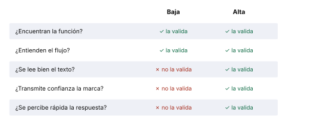

# Tema 1. Fundamentos del prototipado de alta fidelidad {#sec-tema1}

::: {.callout-note appearance="default"}
## Objetivos
- Entender qué es un prototipo de alta fidelidad y en qué se diferencia de la baja fidelidad.
- Saber cuándo conviene subir la fidelidad y qué decisiones permite validar.
- Elegir el tipo de prototipo según la pregunta que se quiere responder.
:::

::: {.callout-note appearance="simple" icon="false"}
## Glosario del tema
[Alta fidelidad](92-glosario.qmd#gl-alta) · [Prototipo](92-glosario.qmd#gl-prototipo) · [Fidelidad](92-glosario.qmd#gl-fidelidad) · [Maqueta](92-glosario.qmd#gl-maqueta) · [Prototipo interactivo](92-glosario.qmd#gl-interactivo) · [Coste del cambio](92-glosario.qmd#gl-coste)
:::

::: {.callout-tip appearance="simple" icon="false"}
## Descargas
[Plantilla de entrega del reto (.qmd)](plantillas/entrega_reto.qmd){.btn .btn-outline-primary .btn-sm download="entrega_reto.qmd"}
[Tema de estilo (.scss)](plantillas/informe.scss){.btn .btn-outline-primary .btn-sm download="informe.scss"}

La plantilla `.qmd` y su tema `.scss` sirven para redactar la entrega de los retos: guárdalos en la misma carpeta.
:::

## Lectura obligatoria

::: {.lectura}
Houde, S.; Hill, C. (1997). [What do prototypes prototype?](https://doi.org/10.1016/B978-044481862-1.50082-0) En M. Helander, T. K. Landauer y P. Prabhu (eds.), *Handbook of Human-Computer Interaction* (2.ª ed., pp. 367-381). Elsevier.
:::

### Lecturas complementarias {.unnumbered}

- Lim, Y.-K.; Stolterman, E.; Tenenberg, J. (2008). [The anatomy of prototypes](https://doi.org/10.1145/1375761.1375762). *ACM Transactions on Computer-Human Interaction*, 15(2), 1-27. Los prototipos como filtros de cualidades del diseño.
- Rudd, J.; Stern, K.; Isensee, S. (1996). [Low vs. high-fidelity prototyping debate](https://doi.org/10.1145/223500.223514). *Interactions*, 3(1), 76-85. Ventajas e inconvenientes de cada fidelidad.
- Walker, M.; Takayama, L.; Landay, J. A. (2002). [High-fidelity or low-fidelity, paper or computer?](https://doi.org/10.1177/154193120204600513) *Proceedings of the HFES Annual Meeting*, 46(5), 661-665.

## 1. Qué es la alta fidelidad

Un prototipo de **alta fidelidad** se parece al producto final en casi todas sus dimensiones: aspecto visual definitivo, contenido real, interactividad detallada y, a veces, datos dinámicos. Lim, Stolterman y Tenenberg (2008) recuerdan que la fidelidad no es una única escala: un prototipo puede tener alta fidelidad visual y baja funcionalidad (una maqueta navegable en Figma que no guarda nada), o al revés.

Lo que define un buen prototipo no es su fidelidad, sino que sea **el más barato que responda a la pregunta**. La alta fidelidad es cara: tiene sentido cuando la pregunta solo puede responderse con un nivel de detalle alto.

## 2. Qué decisiones valida

Houde y Hill (1997) distinguen tres aspectos que puede explorar un prototipo: el **papel** del producto en la vida de las personas, su **apariencia y sensación** (*look and feel*) y su **implementación**. La alta fidelidad es el terreno de la apariencia y la sensación, y empieza a tocar la implementación.

| Pregunta | ¿Hace falta alta fidelidad? |
|---|---|
| ¿Entiende la gente el flujo de reserva? | No: basta un prototipo de baja fidelidad |
| ¿Se lee bien el texto en el móvil con luz exterior? | Sí: depende de la tipografía y el contraste reales |
| ¿Transmite la interfaz confianza y calidad? | Sí: la primera impresión es visual (Tema 2) |
| ¿Se entiende que el botón está cargando? | Sí: depende de la microinteracción (Tema 3) |
| ¿Puede el equipo de desarrollo construirlo? | Sí: hace falta la especificación precisa (Tema 11) |

## 3. Ventajas y riesgos

**Ventajas.** Permite evaluar la legibilidad, la accesibilidad visual y la estética; las personas reaccionan como ante un producto real; sirve para comunicar el diseño a la dirección o a un cliente; y es la base de la especificación para el desarrollo.

**Riesgos.** Rudd, Stern e Isensee (1996) señalaron varios que siguen vigentes:

- **Coste del cambio**: cuanto más pulido está algo, más cuesta cambiarlo, tanto en horas como en apego del equipo.
- **Críticas superficiales**: ante algo que parece terminado, la gente comenta colores y no la estructura.
- **Expectativas falsas**: quien ve un prototipo pulido puede creer que el producto está casi hecho.

Por eso la regla es **subir la fidelidad en el momento justo**: cuando la estructura y el flujo ya funcionan (validado en baja fidelidad) y la siguiente pregunta es visual o de detalle de interacción.

## 4. Tipos de prototipos de alta fidelidad

| Tipo | Qué es | Para qué |
|---|---|---|
| **Maqueta estática** | Pantallas con el aspecto definitivo, sin interacción | Validar el lenguaje visual; presentar (Tema 2) |
| **Prototipo navegable** | Maquetas enlazadas: se puede recorrer el flujo | Pruebas con usuarios del flujo con el aspecto real |
| **Prototipo interactivo** | Con estados, transiciones y microinteracciones | Validar la sensación de uso y la retroalimentación (Tema 3) |
| **Prototipo en código** | Construido con tecnología web real | Validar implementación, rendimiento y accesibilidad con lectores de pantalla |

## Práctica

Toma uno de los prototipos de baja fidelidad que hiciste en la asignatura anterior. Escribe tres preguntas sobre él que **no** puedas responder sin subir la fidelidad, y para cada una indica el tipo de prototipo de la tabla del apartado 4 que usarías.

{#fig-t1-decisiones fig-alt="Tabla con cinco preguntas y dos columnas, baja y alta fidelidad. La baja valida si encuentran la función y si entienden el flujo; no valida si se lee bien el texto, si la marca transmite confianza ni si la respuesta se percibe rápida. La alta valida las cinco."}

## Actividades

::: {.clasificar #ia-t1a-tipo titulo="¿Qué tipo de prototipo de alta fidelidad es?" categorias="Maqueta estática|Prototipo navegable|Prototipo en código"}
- Pantallas definitivas exportadas como imágenes para una presentación → Maqueta estática
- Pantallas enlazadas en una herramienta de diseño, con transiciones → Prototipo navegable
- Una página en HTML y CSS que funciona en el navegador con datos de ejemplo → Prototipo en código
- Un PDF con todas las pantallas del flujo de reserva → Maqueta estática
:::

::: {.clasificar #ia-t1a-cuando titulo="¿Merece la pena la alta fidelidad?" categorias="Sí|Todavía no"}
- Probar si el tono visual encaja con la marca de la universidad → Sí
- Decidir entre tres estructuras de navegación → Todavía no // Explóralas antes en baja fidelidad.
- Comprobar la legibilidad del texto en móvil → Sí
- Presentar el diseño a la dirección para conseguir financiación → Sí
- Descubrir qué necesitan las personas usuarias → Todavía no // Eso es investigación, no prototipado.
:::

::: {.callout-warning appearance="simple" icon="false"}
## Errores frecuentes
- **Saltarse la baja fidelidad** y defender decisiones de estructura que nadie ha probado.
- **Confundir pulido con validado**: una maqueta bonita puede esconder un flujo que no funciona.
- **El efecto «ya está hecho»**: quien ve un prototipo muy pulido opina menos sobre la estructura.
:::

## Reto evaluable {#reto-t1}

::: {.callout-important appearance="simple" icon="false"}
## Reto del Tema 1 · Plan de prototipado
Para el proyecto de la asignatura:

1. Formula **cinco preguntas de diseño** pendientes y clasifícalas con los tres aspectos de Houde y Hill.
2. Para cada pregunta, decide si exige alta fidelidad y qué **tipo de prototipo** usarás, justificando el coste frente a lo que se aprende.
3. Ordena los prototipos en un **plan** con fechas y explica cómo evitarás los riesgos del apartado 3.

**Entrega:** un informe hecho con la [plantilla de entrega](plantillas/entrega_reto.qmd). Se evalúa con la rúbrica que incluye la plantilla. Este reto **no tiene solución en el libro**: cada estudiante trabaja con un proyecto distinto y la corrección la hace el profesorado.
:::

## Autoevaluación

Responde a todas las preguntas y pulsa **Mostrar respuestas**: verás en verde las acertadas, en rojo las falladas y tu recuento. Puedes corregir y volver a comprobar. No cuenta para la nota.

::: {.webex-check .webex-box}
1. Un prototipo con aspecto visual definitivo puede tener baja fidelidad funcional. 
2. Para comprobar si la gente entiende el flujo de reserva hace falta alta fidelidad. 
3. Según Houde y Hill, la alta fidelidad explora sobre todo la 
4. Pantallas con el aspecto definitivo pero sin interacción forman una 
5. ¿Cuál es un riesgo de subir la fidelidad demasiado pronto?



6. Para validar la accesibilidad con lectores de pantalla, el prototipo más adecuado es 
:::

::: {.webex-solution boton="Ver explicaciones"}
- La fidelidad tiene varias dimensiones independientes (Lim et al., 2008).
- El flujo se valida antes y más barato en baja fidelidad.
- La alta fidelidad es el terreno de la apariencia y la sensación.
- Maqueta (*mockup*): aspecto final, sin interacción.
- El coste del cambio y las críticas superficiales son los riesgos clásicos.
- Los lectores de pantalla necesitan el código real para funcionar.
:::

## Recursos complementarios

| Recurso | Para qué sirve |
|---|---|
| [Nielsen Norman Group – UX prototypes: low fidelity vs. high fidelity](https://www.nngroup.com/articles/ux-prototype-hi-lo-fidelity/) | Cuándo usar cada fidelidad |
| [Figma – Guide to prototyping](https://help.figma.com/hc/en-us/articles/360040314193-Guide-to-prototyping-in-Figma) | Prototipos navegables e interactivos |
| [Interaction Design Foundation – Prototyping](https://ixdf.org/literature/topics/prototyping) | Introducción |
