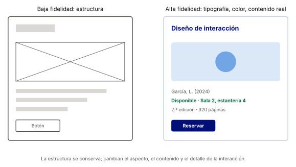

# Tema 3. De la baja a la alta fidelidad {#sec-tema3}

::: {.callout-note appearance="default"}
## Objetivos
- Hacer evolucionar los prototipos de baja a alta fidelidad sin perder la intención del diseño.
- Mantener la trazabilidad de las decisiones.
- Diseñar microinteracciones para los prototipos interactivos.
:::

::: {.callout-note appearance="simple" icon="false"}
## Glosario del tema
[Trazabilidad](92-glosario.qmd#gl-trazabilidad) · [Intención del diseño](92-glosario.qmd#gl-intencion) · [Microinteracción](92-glosario.qmd#gl-microinteraccion) · [Disparador](92-glosario.qmd#gl-disparador) · [Retroalimentación](92-glosario.qmd#gl-retroalimentacion) · [Registro de decisiones](92-glosario.qmd#gl-registro)
:::

::: {.callout-tip appearance="simple" icon="false"}
## Descargas
[Plantilla de entrega del reto (.qmd)](plantillas/entrega_reto.qmd){.btn .btn-outline-primary .btn-sm download="entrega_reto.qmd"}
[Tema de estilo (.scss)](plantillas/informe.scss){.btn .btn-outline-primary .btn-sm download="informe.scss"}
:::

## Lectura obligatoria

::: {.lectura}
Virzi, R. A.; Sokolov, J. L.; Karis, D. (1996). [Usability problem identification using both low- and high-fidelity prototypes](https://doi.org/10.1145/238386.238516). En *Proceedings of the SIGCHI Conference on Human Factors in Computing Systems (CHI '96)* (pp. 236-243). ACM.
:::

### Lecturas complementarias {.unnumbered}

- Saffer, D. (2013). *Microinteractions: Designing with details*. O'Reilly. El modelo de cuatro partes de este tema (bibliografía complementaria de la asignatura).
- Buxton, W. (2007). *Sketching user experiences*. Elsevier. El paso del boceto al prototipo.

## 1. Qué se conserva y qué cambia

Virzi, Sokolov y Karis (1996) compararon los problemas de usabilidad detectados con prototipos de baja y de alta fidelidad y encontraron que ambos los detectan en gran medida por igual. Eso tiene una consecuencia práctica: lo validado en baja fidelidad (estructura, flujo, contenido, jerarquía) es una base sólida que **no debe perderse** al pulir el aspecto.

| Se conserva de la baja fidelidad | Se decide en la alta fidelidad |
|---|---|
| Flujos y pantallas | Tipografía, color, iconos |
| Jerarquía: qué es lo más importante | Cómo se expresa visualmente esa jerarquía |
| Etiquetas y contenido validados | Ajustes de redacción según el espacio real |
| Estados identificados | Diseño detallado de cada estado y microinteracción |

## 2. Estrategias para subir la fidelidad

- **Por capas**: primero la tipografía y el espaciado sobre el esquema, después el color, después los iconos e imágenes. Cada capa se revisa antes de añadir la siguiente.
- **Por pantallas clave**: llevar a alta fidelidad una o dos pantallas representativas, extraer de ellas los estilos y componentes, y aplicarlos al resto (lo que da origen al sistema de diseño, Tema 9).
- **Fidelidad mixta**: alta fidelidad solo donde la pregunta lo exige (la pantalla de pago) y baja en el resto.

## 3. Trazabilidad de las decisiones

Al pulir, es fácil que una decisión visual contradiga, sin querer, una decisión validada: un botón principal que pierde protagonismo porque «quedaba mejor» en gris, una etiqueta que se acorta y deja de entenderse. La **trazabilidad** consiste en poder explicar de dónde viene cada decisión. Un **registro de decisiones** sencillo ayuda:

| Fecha | Decisión | Motivo | Evidencia | Pantallas afectadas |
|---|---|---|---|---|
| 12/02 | El horario pasa a la cabecera | 4 de 6 lo buscaban en «Contacto» | Prueba en papel, ronda 2 | Todas |
| 19/02 | Botón «Reservar» en color primario sólido | Acción principal del flujo | Jerarquía validada en esquemas | Lista y ficha de sala |

## 4. Microinteracciones

Una **microinteracción** es un momento de interacción con un solo propósito: marcar un favorito, activar un ajuste, recibir la confirmación de una reserva. Saffer (2013) describe cuatro partes:

1. **Disparador**: lo que la inicia (una acción de la persona o una condición del sistema).
2. **Reglas**: qué ocurre y en qué orden.
3. **Retroalimentación**: cómo se comunica lo que está pasando (visual, sonora, táctil).
4. **Bucles y modos**: qué cambia si se repite o si hay estados distintos.

| Parte | Ejemplo: «Añadir a mi lista de lecturas» |
|---|---|
| Disparador | Pulsar el icono de marcador en la ficha del libro |
| Reglas | Si hay sesión, se añade; si no, se pide iniciarla y después se añade |
| Retroalimentación | El icono pasa a relleno y aparece «Añadido a tu lista» con opción «Deshacer» |
| Bucles y modos | Pulsar de nuevo lo quita; el estado se mantiene al volver a la ficha |

Las animaciones de las microinteracciones deben ser breves y útiles, y respetar la preferencia de **movimiento reducido** del sistema: algunas personas sufren mareos o pierden la concentración con el movimiento (criterio de las WCAG sobre animaciones de interacción).

## Práctica

Toma una pantalla de un prototipo de baja fidelidad tuyo. Súbela a alta fidelidad por capas (tipografía, color, iconos) y, en cada capa, comprueba con su esquema original que la jerarquía no ha cambiado.

{#fig-t3-transicion fig-alt="Dos pantallas lado a lado. A la izquierda, un esquema gris con un recuadro tachado para la imagen, líneas grises de texto y un botón con la palabra Botón. A la derecha, la misma estructura con un título azul, una imagen de color, la referencia, el texto «Disponible, sala 2, estantería 4» en verde y un botón azul oscuro «Reservar»."}

## Laboratorio: estados de un componente {#lab-t3-estados}

::: {.laboratorio}
::: {.laboratorio-etiqueta}
Laboratorio · se ejecuta en tu navegador
:::

Un componente de alta fidelidad no es una imagen: tiene **estados**. Prueba el botón con el ratón y **con el teclado** (tabulador para el foco, Intro o espacio para pulsarlo). Activa los estados que el diseño debe especificar y comprueba cómo se ven.

```{ojs}
//| echo: false
seleccion = window.Lab.seleccion
viewof estado_boton = seleccion("Estado forzado", [["reposo", "Reposo (interactivo)"], ["desactivado", "Desactivado"], ["cargando", "Cargando"], ["error", "Error"], ["exito", "Éxito"]], {value: "reposo"})
```

```{ojs}
//| echo: false
{
  const e = estado_boton;
  const etiqueta = {reposo: "Reservar", desactivado: "Reservar", cargando: "Reservando…", error: "Reintentar", exito: "Reservado ✓"}[e];
  const ayuda = {reposo: "Pasa el ratón, pulsa o usa el tabulador: verás los estados :hover, :active y :focus-visible.",
    desactivado: "Desactivado: no responde. Explica por qué cerca del botón («No se puede reservar: ya tienes 5 reservas»).",
    cargando: "Cargando: evita el doble envío y comunica que el sistema trabaja (aria-busy).",
    error: "Error: el mensaje dice qué pasó y la acción permite recuperarse.",
    exito: "Éxito: confirma el resultado sin obligar a buscarlo."}[e];
  const d = document.createElement("div"); d.className = "lab-estados";
  const b = document.createElement("button"); b.type = "button"; b.className = "lab-boton lab-" + e;
  if (e === "desactivado") b.disabled = true;
  b.setAttribute("aria-busy", String(e === "cargando"));
  if (e === "cargando") { const g = document.createElement("span"); g.className = "lab-giro"; g.setAttribute("aria-hidden", "true"); b.append(g); }
  b.append(etiqueta); d.append(b);
  if (e === "error") { const p = document.createElement("p"); p.className = "lab-mal small mt-1 mb-0"; p.textContent = "No se ha podido reservar: comprueba tu conexión."; d.append(p); }
  const st = document.createElement("p"); st.className = "small mt-2"; st.setAttribute("role", "status"); st.textContent = ayuda; d.append(st);
  let n = 0;
  if (e === "reposo") b.onclick = () => { n++; st.textContent = `Pulsado ${n} ${n === 1 ? "vez" : "veces"}. ¿Has visto el cambio al pulsar y el anillo de foco con el teclado?`; };
  return d;
}
```
:::

## Laboratorio: editor de curvas de animación {#lab-t3-curvas}

::: {.laboratorio}
::: {.laboratorio-etiqueta}
Laboratorio · se ejecuta en tu navegador
:::

La **curva de aceleración** (*easing*) decide cómo se reparte el movimiento en el tiempo. En la vida real nada empieza ni se detiene de golpe: por eso `linear` parece mecánico. Ajusta los puntos de control de la curva de Bézier, elige la duración y pulsa «Reproducir».

```{ojs}
//| echo: false
selC = window.Lab.seleccion
rangoC = window.Lab.rango
viewof preset = selC("Punto de partida", ["ease-out · entrar", "ease-in · salir", "ease-in-out · moverse", "linear · mecánico", "personalizada"], {value: "ease-out · entrar"})
viewof x1 = rangoC("x₁", [0, 1], {step: 0.01, value: 0, formato: (v) => v.toFixed(2).replace(".", ",")})
viewof y1 = rangoC("y₁", [-0.5, 1.5], {step: 0.01, value: 0, formato: (v) => v.toFixed(2).replace(".", ",")})
viewof x2 = rangoC("x₂", [0, 1], {step: 0.01, value: 0.58, formato: (v) => v.toFixed(2).replace(".", ",")})
viewof y2 = rangoC("y₂", [-0.5, 1.5], {step: 0.01, value: 1, formato: (v) => v.toFixed(2).replace(".", ",")})
viewof duracion = rangoC("Duración (ms)", [100, 1000], {step: 50, value: 250})
```

```{ojs}
//| echo: false
{
  const P = {"ease-out · entrar": [0, 0, 0.58, 1], "ease-in · salir": [0.42, 0, 1, 1], "ease-in-out · moverse": [0.42, 0, 0.58, 1], "linear · mecánico": [0, 0, 1, 1]};
  const [a, b, c, d] = preset === "personalizada" ? [x1, y1, x2, y2] : P[preset];
  const W = 240, X = (v) => 30 + v * W, Y = (v) => 30 + (1 - v) * 200;
  const reducir = window.matchMedia("(prefers-reduced-motion: reduce)").matches;
  const f = (v) => +v.toFixed(2);
  const css = `transition: transform ${duracion}ms cubic-bezier(${f(a)}, ${f(b)}, ${f(c)}, ${f(d)});`;
  const el = html`<div role="group" aria-label="Vista previa de la curva">
    <svg viewBox="0 0 300 260" width="300" role="img" aria-label="Curva de Bézier con puntos de control (${f(a)}, ${f(b)}) y (${f(c)}, ${f(d)})" style="max-width:100%">
      <rect x="30" y="30" width="${W}" height="200" fill="none" stroke="currentColor" stroke-opacity="0.25"/>
      <text x="30" y="250" font-size="11" fill="currentColor">tiempo →</text><text x="6" y="34" font-size="11" fill="currentColor">fin</text>
      <line x1="${X(0)}" y1="${Y(0)}" x2="${X(a)}" y2="${Y(b)}" stroke="#d6336c" stroke-dasharray="4 3"/><line x1="${X(1)}" y1="${Y(1)}" x2="${X(c)}" y2="${Y(d)}" stroke="#d6336c" stroke-dasharray="4 3"/>
      <path d="M${X(0)} ${Y(0)} C ${X(a)} ${Y(b)}, ${X(c)} ${Y(d)}, ${X(1)} ${Y(1)}" fill="none" stroke="#2a78d6" stroke-width="3"/>
      <circle cx="${X(a)}" cy="${Y(b)}" r="6" fill="#d6336c"/><circle cx="${X(c)}" cy="${Y(d)}" r="6" fill="#d6336c"/>
    </svg>
    <div style="position:relative;height:56px;max-width:420px;border:1px solid var(--bs-border-color);border-radius:28px;margin:.5rem 0">
      <div class="bola" style="position:absolute;left:6px;top:6px;width:44px;height:44px;border-radius:50%;background:#2a78d6"></div>
    </div>
    <button type="button" class="btn btn-primary btn-sm">Reproducir</button>
    <pre class="mt-2"><code>${css}</code></pre>
    <p class="small" aria-live="polite"></p>
  </div>`;
  const bola = el.querySelector(".bola"), msg = el.querySelector("p");
  el.querySelector("button").onclick = () => {
    const fin = bola.style.transform === "translateX(360px)" ? "translateX(0)" : "translateX(360px)";
    bola.style.transition = reducir ? "none" : `transform ${duracion}ms cubic-bezier(${a}, ${b}, ${c}, ${d})`;
    bola.style.transform = fin;
    msg.textContent = reducir ? "Tu sistema pide reducir el movimiento: la bola salta sin animación, como debería hacer tu interfaz." : "";
  };
  msg.textContent = duracion > 500 ? "Más de 500 ms se percibe lento para una microinteracción; resérvalo para transiciones grandes." : (b < 0 || b > 1 || d < 0 || d > 1) ? "Los valores fuera de 0–1 producen un rebote: úsalo con moderación." : "";
  return el;
}
```

**Regla práctica.** Los elementos que **entran** usan *ease-out* (llegan rápido y frenan), los que **salen** usan *ease-in* y los que se **desplazan** dentro de la pantalla usan *ease-in-out*. Entre 150 y 300 ms basta para casi todas las microinteracciones.
:::

## Caso práctico resuelto

::: {.callout-note appearance="simple" icon="false"}
## Del esquema a la pantalla final, decisión a decisión
Paso del esquema de confirmación a alta fidelidad:

1. **Jerarquía:** el título «Reserva confirmada» pasa a 24 px seminegrita; los datos de la reserva, a 16 px.
2. **Color:** el verde se reserva para el estado de éxito; la acción secundaria («Cancelar») va en contorno.
3. **Iconografía:** iconos de calendario, reloj y ubicación junto a cada dato, siempre con texto.
4. **Espaciado:** escala de 8 px; 24 px entre bloques, 8 px dentro de cada bloque.
5. **Microinteracción:** al confirmar, una animación breve (≤ 300 ms) que respeta la preferencia de reducir el movimiento.

Cada decisión se registra en la documentación para que desarrollo no tenga que adivinar.
:::

## Ejercicios graduados

**Básico.** ¿Qué elementos del esquema no deberían cambiar al pasar a alta fidelidad?

::: {.webex-solution boton="Ver solución"}
La estructura, la jerarquía de la información y el flujo validados. La alta fidelidad añade aspecto y detalle; si cambia la estructura, hay que volver a probarla.
:::

**Avanzado.** Escribe la ficha de decisiones (jerarquía, color, iconos, espaciado, movimiento) para la pantalla de lista de salas.

::: {.webex-solution boton="Ver solución"}
Debe justificar cada decisión con un principio (contraste, consistencia, escala de espaciado, accesibilidad) y especificar valores concretos que desarrollo pueda aplicar.
:::


## Actividades

::: {.clasificar #ia-t3a-cambia titulo="¿Se conserva o cambia al subir la fidelidad?" categorias="Se conserva|Cambia"}
- La arquitectura de información validada → Se conserva
- El orden de los pasos del flujo → Se conserva
- La tipografía y el color → Cambia
- Los textos provisionales por textos reales → Cambia
- Las decisiones tomadas tras las pruebas con usuarios → Se conserva
- El detalle de las microinteracciones → Cambia
:::

::: {.ordenar #ia-t3a-micro titulo="Las cuatro partes de una microinteracción (Saffer, 2013)"}
1. Disparador: qué la inicia
2. Reglas: qué ocurre
3. Retroalimentación: cómo se percibe lo que ocurre
4. Bucles y modos: qué pasa con el tiempo o en situaciones especiales
:::

## Reto evaluable {#reto-t3}

::: {.callout-important appearance="simple" icon="false"}
## Reto del Tema 3 · Evolución trazable y microinteracción
Para tu proyecto:

1. Lleva a alta fidelidad **dos pantallas** del flujo principal partiendo de sus esquemas, mostrando las capas intermedias.
2. Mantén un **registro de decisiones** con al menos seis entradas, cada una con su evidencia.
3. Diseña **una microinteracción** clave con las cuatro partes de Saffer y prototípala, incluida su versión con movimiento reducido.

**Entrega:** un informe hecho con la [plantilla de entrega](plantillas/entrega_reto.qmd) con las imágenes y el enlace al prototipo. Se evalúa con la rúbrica que incluye la plantilla. Este reto **no tiene solución en el libro**: cada estudiante trabaja con un proyecto distinto y la corrección la hace el profesorado.
:::

## Autoevaluación

Responde a todas las preguntas y pulsa **Mostrar respuestas**: verás en verde las acertadas, en rojo las falladas y tu recuento. Puedes corregir y volver a comprobar. No cuenta para la nota.

::: {.webex-check .webex-box}
1. Según Virzi et al., los prototipos de baja fidelidad detectan muchos menos problemas que los de alta. 
2. Al subir la fidelidad, la jerarquía de la información validada en los esquemas debe 
3. En el modelo de Saffer, pulsar el icono de marcador es el  de la microinteracción.
4. El cambio del icono a relleno con el mensaje «Añadido a tu lista» es la 
5. Las animaciones de interacción deben respetar la preferencia de movimiento reducido del sistema. 
6. ¿Para qué sirve el registro de decisiones?


:::

::: {.webex-solution boton="Ver explicaciones"}
- Detectaron problemas en gran medida similares.
- Lo validado es la base: el aspecto visual la expresa, no la sustituye.
- El disparador inicia la microinteracción.
- La retroalimentación comunica lo que ha pasado.
- Algunas personas sufren mareos con el movimiento.
- La trazabilidad protege las decisiones validadas.
:::

## Recursos complementarios

| Recurso | Para qué sirve |
|---|---|
| [W3C – Understanding SC 2.3.3: Animation from interactions](https://www.w3.org/WAI/WCAG22/Understanding/animation-from-interactions.html) | Animaciones y movimiento reducido |
| [Nielsen Norman Group – Microinteractions in user experience](https://www.nngroup.com/articles/microinteractions/) | Ejemplos de microinteracciones |
| [Figma – Guide to prototyping](https://help.figma.com/hc/en-us/articles/360040314193-Guide-to-prototyping-in-Figma) | Interacciones y animaciones en prototipos |
