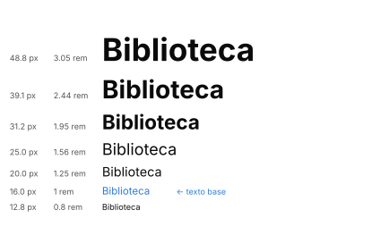

# Tema 4. La tipografía en el diseño de interfaces {#sec-tema4}

::: {.callout-note appearance="default"}
## Objetivos
- Elegir familias tipográficas adecuadas para interfaces.
- Construir escalas tipográficas y jerarquías coherentes.
- Ajustar el espaciado, la longitud de línea y el contraste para la legibilidad.
:::

::: {.callout-note appearance="simple" icon="false"}
## Glosario del tema
[Familia tipográfica](92-glosario.qmd#gl-familia) · [Escala modular](92-glosario.qmd#gl-escala) · [Interlineado](92-glosario.qmd#gl-interlineado) · [Longitud de línea](92-glosario.qmd#gl-longitud) · [Legibilidad](92-glosario.qmd#gl-legibilidad) · [Altura de la x](92-glosario.qmd#gl-altura-x) · [Unidad rem](92-glosario.qmd#gl-rem)
:::

::: {.callout-tip appearance="simple" icon="false"}
## Descargas
[Script R del capítulo](plantillas/04_tipografia.R){.btn .btn-outline-primary .btn-sm download="04_tipografia.R"}
[Plantilla de entrega del reto (.qmd)](plantillas/entrega_reto.qmd){.btn .btn-outline-primary .btn-sm download="entrega_reto.qmd"}
[Tema de estilo (.scss)](plantillas/informe.scss){.btn .btn-outline-primary .btn-sm download="informe.scss"}
:::

## Lectura obligatoria

::: {.lectura}
Dyson, M. C. (2004). [How physical text layout affects reading from screen](https://doi.org/10.1080/01449290410001715714). *Behaviour & Information Technology*, 23(6), 377-393.
:::

### Lecturas complementarias {.unnumbered}

- Lupton, E. (2024). *Pensar con tipos* (ed. de D. Giménez). Gustavo Gili. Fundamentos de tipografía (bibliografía complementaria de la asignatura).
- Material Design 3. [Typography](https://m3.material.io/styles/typography/overview). Una escala tipográfica de sistema documentada.

## 1. Elegir la familia tipográfica

En las interfaces, la tipografía es sobre todo **texto que se lee para hacer algo**: etiquetas, botones, mensajes, contenidos. Para elegir una familia conviene comprobar:

- **Legibilidad a tamaños pequeños**: altura de la x generosa (la altura de las minúsculas sin ascendentes), formas abiertas y letras que no se confundan (I, l y 1; O y 0).
- **Variedad de pesos y estilos** suficiente para construir la jerarquía sin añadir otras familias.
- **Soporte de idiomas**: todos los caracteres que se necesitan (tildes, eñe, otros alfabetos si hay versiones en otras lenguas).
- **Rendimiento y licencia**: tipografías del sistema o web con licencia adecuada y un peso de carga razonable.

En la mayoría de los productos bastan **una o dos familias**: una para el texto y, si acaso, otra para los titulares o los datos.

## 2. Escalas y jerarquía

Una **escala modular** fija los tamaños a partir de un tamaño base y una razón constante: cada nivel multiplica el anterior por la razón. Razones habituales: 1,125, 1,2, 1,25, 1,333 o 1,5. Con base de 16 px y razón 1,25 salen 16, 20, 25, 31, 39… Usar una escala evita tamaños arbitrarios y da coherencia.

La jerarquía no se construye solo con el tamaño: también con el **peso** (regular, semibold, bold), el **color** (texto principal y secundario, siempre con contraste suficiente) y el **espacio** alrededor. Un sistema típico tiene pocos estilos con nombre: título de pantalla, título de sección, cuerpo, cuerpo pequeño, etiqueta, botón.

{#fig-escala fig-alt="Seis líneas de texto «Biblioteca» de tamaño creciente, de 12,8 a 48,8 píxeles, con su tamaño en píxeles y en rem a la izquierda. El tamaño de 16 px aparece marcado como texto base."}

## 3. Espaciado y longitud de línea

- **Interlineado**: para el texto de lectura, en torno a 1,5 veces el tamaño de la letra; los titulares necesitan menos. Las WCAG exigen que el contenido siga funcionando si la persona aumenta el interlineado hasta 1,5 y el espacio entre párrafos hasta 2 veces el tamaño.
- **Longitud de línea**: Dyson (2004) revisó la investigación sobre la lectura en pantalla y encontró que las líneas largas se leen algo más rápido, pero que las personas prefieren longitudes moderadas. Como regla práctica de diseño se usan de 45 a 75 caracteres por línea para el texto de lectura.
- **Tamaño**: 16 px es el tamaño de referencia del texto de los navegadores; el texto de lectura no debería ser menor en móvil.
- **Unidades relativas** (rem): permiten que la interfaz respete el tamaño de letra que la persona ha elegido en su sistema.

## 4. Legibilidad y contraste

La legibilidad depende también del **contraste** con el fondo: las WCAG exigen 4,5:1 para el texto normal y 3:1 para el texto grande (desde 24 px, o 18,66 px en negrita). El texto gris claro sobre blanco, tan frecuente, suele incumplirlo (Tema 5). Hay que evitar además el texto justificado en pantalla (crea huecos irregulares), los textos largos en mayúsculas y el texto sobre imágenes sin una capa que asegure el contraste.

## Práctica en R: escalas tipográficas

`escala_tipografica()` calcula los tamaños de una escala, su equivalente en rem y una altura de línea orientativa:

```{webr}
#| autorun: true
source("datos/funciones_ux.R")
escala_tipografica(base = 16, razon = 1.25, pasos = -1:5)
```

### Ejercicio 4.1 {.unnumbered}

Calcula el tamaño del paso 3 de una escala de base 16 px y razón **1,333** (cuarta justa).

```{webr}
#| exercise: t4_escala
#| setup: true
source("datos/funciones_ux.R")
```

```{webr}
#| exercise: t4_escala
e <- escala_tipografica(base = 16, razon = ______, pasos = 0:3)
e$px[e$paso == 3]
```

::: {.hint exercise="t4_escala"}
Escribe la razón con punto decimal: `1.333`.
:::

::: {.solution exercise="t4_escala"}
```r
e <- escala_tipografica(base = 16, razon = 1.333, pasos = 0:3)
e$px[e$paso == 3]
```
37,9 px. Con una razón mayor, la escala crece más deprisa: sirve para interfaces con mucho contraste entre titulares y texto; para interfaces densas se prefieren razones menores.
:::

```{webr}
#| exercise: t4_escala
#| check: true
if (isTRUE(all.equal(as.numeric(.result), 37.9))) {
  list(correct = TRUE, message = "Correcto: 16 × 1,333³ ≈ 37,9 px.")
} else {
  list(correct = FALSE, message = "Usa razon = 1.333.")
}
```

### Ejercicio 4.2 {.unnumbered}

¿Cuántos caracteres caben, aproximadamente, en un bloque de 720 px con letra de 18 px? `caracteres_por_linea()` supone un ancho medio de 0,5 em por carácter. ¿Está dentro del intervalo de 45 a 75?

```{webr}
#| exercise: t4_linea
#| setup: true
source("datos/funciones_ux.R")
```

```{webr}
#| exercise: t4_linea
caracteres_por_linea(ancho = ______, tamano = 18)
```

::: {.hint exercise="t4_linea"}
El ancho del bloque es 720 px.
:::

::: {.solution exercise="t4_linea"}
```r
caracteres_por_linea(ancho = 720, tamano = 18)
```
80 caracteres: algo por encima del intervalo cómodo. Habría que estrechar el bloque o aumentar algo el tamaño.
:::

```{webr}
#| exercise: t4_linea
#| check: true
if (identical(as.numeric(.result), 80)) {
  list(correct = TRUE, message = "Correcto: unos 80 caracteres, algo largo.")
} else {
  list(correct = FALSE, message = "El ancho es 720.")
}
```

## Laboratorio tipográfico {#lab-t4-tipo}

::: {.laboratorio}
::: {.laboratorio-etiqueta}
Laboratorio · se ejecuta en tu navegador
:::

Elige un tamaño base y una **razón** de escala modular: cada nivel de la jerarquía se obtiene multiplicando por la razón. Ajusta el interlineado y el ancho de la columna y mira el resultado con un texto real.

```{ojs}
//| echo: false
rango = window.Lab.rango
seleccion = window.Lab.seleccion
viewof t_base = rango("Tamaño base (px)", [12, 22], {step: 1, value: 16})
viewof t_razon = seleccion("Razón de la escala", [["1.125", "1,125 · segunda mayor"], ["1.2", "1,2 · tercera menor"], ["1.25", "1,25 · tercera mayor"], ["1.333", "1,333 · cuarta justa"], ["1.5", "1,5 · quinta justa"], ["1.618", "1,618 · proporción áurea"]], {value: "1.25"})
viewof t_inter = rango("Interlineado del texto", [1.0, 2.0], {step: 0.05, value: 1.5, formato: x => x.toFixed(2).replace(".", ",")})
viewof t_medida = rango("Ancho de la columna (em)", [20, 60], {step: 1, value: 34})
```

```{ojs}
//| echo: false
{
  const r = +t_razon, b = t_base;
  const niveles = [["Título 1", 4], ["Título 2", 3], ["Título 3", 2], ["Título 4", 1], ["Texto", 0], ["Pie", -1]];
  const px = k => b * Math.pow(r, k);
  const cpl = Math.round(t_medida * 2);
  const est = cpl < 45 ? ["corta", "lab-medio"] : cpl > 75 ? ["larga", "lab-medio"] : ["cómoda", "lab-bien"];
  const d = html`<div role="status"></div>`;
  d.innerHTML = `<table class="table table-sm"><thead><tr><th scope="col">Nivel</th><th scope="col">px</th><th scope="col">rem</th></tr></thead><tbody>
    ${niveles.map(([n, k]) => `<tr><td>${n}</td><td>${px(k).toFixed(1).replace(".", ",")}</td><td>${(px(k) / 16).toFixed(3).replace(".", ",")}</td></tr>`).join("")}</tbody></table>
    <div class="lab-muestra-tipo" style="max-width:${t_medida}em;font-size:${b}px;border:1px solid var(--bs-border-color);border-radius:6px;padding:1em">
      <div style="font-size:${px(3)}px;line-height:1.2;font-weight:600;margin-bottom:.4em">Reserva una sala de estudio</div>
      <div style="font-size:${px(1)}px;line-height:1.3;font-weight:600;margin-bottom:.3em">Elige el día y la franja</div>
      <p style="line-height:${t_inter};margin:0 0 .6em">Las salas se reservan con un máximo de siete días de antelación y durante un máximo de tres horas seguidas. Si no llegas en los primeros quince minutos, la reserva se libera para otra persona.</p>
      <div style="font-size:${px(-1)}px;line-height:1.4">Normas de uso actualizadas el 1 de septiembre.</div></div>
    <p class="small mt-2">Unos ${cpl} caracteres por línea: <span class="${est[1]}" style="font-weight:600">${est[0]}</span> (lo cómodo es 45-75). Con las funciones del libro: <code>escala_tipografica(${b}, ${r})</code>.</p>`;
  return d;
}
```
:::

## Caso práctico resuelto

::: {.callout-note appearance="simple" icon="false"}
## Una escala tipográfica para ReservaSala
Se elige una tipografía sin serifa de buena legibilidad en pantalla y una escala con razón 1,25 a partir de 16 px:

| Uso | Tamaño | Peso | Interlineado |
|---|---|---|---|
| Título de pantalla | 25 px | Seminegrita | 1,2 |
| Encabezado de sección | 20 px | Seminegrita | 1,3 |
| Texto | 16 px | Regular | 1,5 |
| Texto secundario | 13 px | Regular | 1,4 |

Reglas: no más de dos pesos por pantalla; longitud de línea de 45 a 75 caracteres en escritorio; los números de las horas con cifras tabulares para que se alineen en la lista.
:::

## Ejercicios graduados

**Básico.** Calcula los tamaños de una escala de razón 1,2 a partir de 16 px (tres pasos hacia arriba).

::: {.webex-solution boton="Ver solución"}
16 × 1,2 = 19,2 → 19 px; 19,2 × 1,2 = 23,04 → 23 px; 23,04 × 1,2 = 27,6 → 28 px.
:::

**Avanzado.** Explica por qué conviene usar cifras tabulares en la lista de horarios.

::: {.webex-solution boton="Ver solución"}
Porque todas las cifras ocupan el mismo ancho y las horas quedan alineadas en columna, lo que facilita comparar franjas de un vistazo.
:::


## Actividades

::: {.clasificar #ia-t4a-familia titulo="¿Qué familia elegirías?" categorias="Sin serifa humanista|Serifa|Monoespaciada|Ninguna de estas"}
- Texto de interfaz en pantallas pequeñas → Sin serifa humanista // Formas abiertas, buena legibilidad a tamaños pequeños.
- Fragmentos de código o números de referencia que hay que alinear → Monoespaciada
- Textos largos de lectura continua en una revista digital → Serifa // También funcionan bien muchas sin serifa: lo importante es la legibilidad.
- Una tipografía decorativa de caligrafía para los botones → Ninguna de estas // Las decorativas no sirven para la interfaz.
:::

::: {.clasificar #ia-t4a-errores titulo="¿Buena o mala práctica tipográfica?" categorias="Buena práctica|Mala práctica"}
- Definir los tamaños en rem para que respeten el ajuste del navegador → Buena práctica
- Usar seis tamaños distintos sin relación entre ellos → Mala práctica
- Justificar el texto en columnas estrechas → Mala práctica // Crea ríos de espacio blanco.
- Interlineado de 1,4-1,6 para el texto de párrafo → Buena práctica
- Escribir títulos largos todo en mayúsculas → Mala práctica
- Limitar el número de pesos a dos o tres → Buena práctica
:::

## Reto evaluable {#reto-t4}

::: {.callout-important appearance="simple" icon="false"}
## Reto del Tema 4 · Sistema tipográfico del proyecto
Para tu proyecto:

1. Elige **una o dos familias** y justifica la elección con los criterios del apartado 1 (incluye una prueba de los caracteres confundibles).
2. Define una **escala modular** con `escala_tipografica()` y los estilos con nombre que usarás (al menos seis), con tamaño, peso, interlineado y uso.
3. Comprueba la **longitud de línea** del texto de lectura en escritorio y en móvil.
4. Aplica el sistema a dos pantallas y muestra el antes y el después.

**Entrega:** un informe hecho con la [plantilla de entrega](plantillas/entrega_reto.qmd). Se evalúa con la rúbrica que incluye la plantilla. Este reto **no tiene solución en el libro**: cada estudiante trabaja con un proyecto distinto y la corrección la hace el profesorado.
:::

## Autoevaluación

Responde a todas las preguntas y pulsa **Mostrar respuestas**: verás en verde las acertadas, en rojo las falladas y tu recuento. Puedes corregir y volver a comprobar. No cuenta para la nota.

::: {.webex-check .webex-box}
1. En una escala modular, cada tamaño se obtiene multiplicando el anterior por una razón constante. 
2. Con base 16 px y razón 1,25, el paso 2 mide  px.
3. Para el texto de lectura se suele recomendar una longitud de línea de 
4. El texto justificado es recomendable en las interfaces porque ordena los márgenes. 
5. ¿Por qué se prefieren las unidades rem para el tamaño del texto?



6. Según las WCAG, el texto grande empieza en 
:::

::: {.webex-solution boton="Ver explicaciones"}
- Esa es la definición de escala modular.
- 16 × 1,25 × 1,25 = 25.
- Es la regla práctica habitual para la lectura cómoda.
- Crea huecos irregulares entre palabras que dificultan la lectura.
- Se escalan con la preferencia de tamaño del sistema o del navegador.
- El texto grande tiene un mínimo de contraste más bajo (3:1).
:::

## Recursos complementarios

| Recurso | Para qué sirve |
|---|---|
| [Material Design 3 – Typography](https://m3.material.io/styles/typography/overview) | Escala tipográfica de sistema |
| [Apple Human Interface Guidelines – Typography](https://developer.apple.com/design/human-interface-guidelines/typography) | Tipografía en las plataformas de Apple |
| [W3C – Understanding SC 1.4.12: Text spacing](https://www.w3.org/WAI/WCAG22/Understanding/text-spacing.html) | Espaciado de texto ajustable |
| [Butterick's Practical Typography](https://practicaltypography.com/) | Guía práctica de tipografía |
