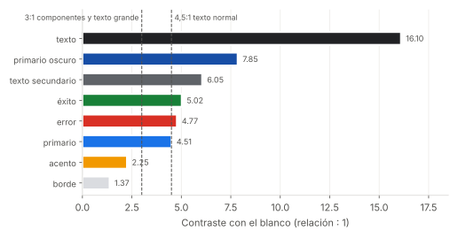

# Tema 5. Uso accesible del color {#sec-tema5}

::: {.callout-note appearance="default"}
## Objetivos
- Aplicar nociones de teoría del color a las interfaces.
- Construir paletas accesibles que cumplan los contrastes mínimos de las WCAG.
- Diseñar para las personas con daltonismo y tener en cuenta los significados culturales del color.
:::

::: {.callout-note appearance="simple" icon="false"}
## Glosario del tema
[Tono, saturación y luminosidad](92-glosario.qmd#gl-hsl) · [Luminancia relativa](92-glosario.qmd#gl-luminancia) · [Contraste](92-glosario.qmd#gl-contraste) · [Daltonismo](92-glosario.qmd#gl-daltonismo) · [Color semántico](92-glosario.qmd#gl-semantico) · [Paleta](92-glosario.qmd#gl-paleta)
:::

::: {.callout-tip appearance="simple" icon="false"}
## Descargas
[Script R del capítulo](plantillas/05_color.R){.btn .btn-outline-primary .btn-sm download="05_color.R"}
[Plantilla de entrega del reto (.qmd)](plantillas/entrega_reto.qmd){.btn .btn-outline-primary .btn-sm download="entrega_reto.qmd"}
[Tema de estilo (.scss)](plantillas/informe.scss){.btn .btn-outline-primary .btn-sm download="informe.scss"}
:::

## Lectura obligatoria

::: {.lectura}
Machado, G. M.; Oliveira, M. M.; Fernandes, L. A. F. (2009). [A physiologically-based model for simulation of color vision deficiency](https://doi.org/10.1109/TVCG.2009.113). *IEEE Transactions on Visualization and Computer Graphics*, 15(6), 1291-1298.
:::

### Lecturas complementarias {.unnumbered}

- W3C (2023). [Understanding SC 1.4.3: Contrast (minimum)](https://www.w3.org/WAI/WCAG22/Understanding/contrast-minimum.html). La justificación del umbral de 4,5:1.
- Malloy, V. (2015). *Intersecting colors: Josef Albers and his contemporaries*. Amherst College Press. La interacción del color en la tradición de Albers (bibliografía complementaria de la asignatura).
- WebAIM. [Contrast and color accessibility](https://webaim.org/articles/contrast/). Guía práctica.

## 1. Teoría del color para interfaces

Un color se describe mejor, para diseñar, por su **tono** (la posición en el círculo cromático), su **saturación** (intensidad) y su **luminosidad** (claridad). Las combinaciones clásicas (análogas, complementarias, triádicas) son un punto de partida, pero en las interfaces el color tiene sobre todo **funciones**:

- **Marca**: identifica el producto.
- **Jerarquía**: atrae la atención hacia la acción principal.
- **Semántica**: comunica estados (error, aviso, éxito, información).
- **Agrupación**: relaciona elementos.

Una paleta de interfaz suele tener un color primario, uno o dos de acento, los colores semánticos y una escala de grises para textos, bordes y fondos, cada uno en varios tonos más claros y más oscuros.

## 2. Contraste: los mínimos de las WCAG

El contraste se mide con la **relación de contraste** de las WCAG, calculada a partir de la **luminancia relativa** de los dos colores: va de 1:1 (iguales) a 21:1 (negro sobre blanco). Los mínimos de nivel AA son:

| Qué | Mínimo AA | Mínimo AAA |
|---|---|---|
| Texto normal | 4,5:1 | 7:1 |
| Texto grande (desde 24 px, o 18,66 px en negrita) | 3:1 | 4,5:1 |
| Componentes de interfaz y gráficos (bordes de campos, iconos que transmiten información, foco) | 3:1 | — |

El contraste depende de la luminosidad, no del tono: un naranja y un azul muy saturados pueden tener poco contraste entre sí y con el blanco.

{#fig-contraste fig-alt="Gráfico de barras horizontales con ocho colores de la paleta ordenados por su contraste con el blanco, de 16,1 (texto) a 1,4 (borde). Dos líneas verticales marcan 3:1 y 4,5:1. El acento naranja (2,25) y el borde gris (1,37) quedan por debajo de ambas; el primario azul (4,51) queda justo por encima de 4,5."}

## 3. Daltonismo

Alrededor del 8 % de los hombres y del 0,5 % de las mujeres de ascendencia europea tienen alguna deficiencia en la visión de los colores. Las más frecuentes afectan al eje **rojo-verde** (protanopía y deuteranopía, y sus formas parciales); la tritanopía (azul-amarillo) es rara. Machado, Oliveira y Fernandes (2009) propusieron un modelo basado en la fisiología de los conos que permite **simular** cómo ve los colores una persona con cada deficiencia, y es el que usan muchas herramientas de diseño.

Las reglas prácticas:

- **No transmitir información solo con el color** (criterio 1.4.1 de las WCAG): los estados llevan además icono y texto; los enlaces, subrayado o forma; los gráficos, etiquetas o texturas.
- Comprobar que los colores que deben distinguirse lo hacen también por **luminosidad**.
- Simular la paleta antes de cerrarla.

## 4. Consideraciones culturales

Los significados del color no son universales. El rojo es peligro o error en muchas interfaces occidentales, pero se asocia a la suerte y la celebración en China; el blanco es luto en partes de Asia oriental; el verde tiene connotaciones religiosas en algunos contextos. En productos internacionales conviene apoyarse en las convenciones de la plataforma, acompañar el color de iconos y texto, y comprobar los significados con personas de cada mercado.

## Práctica en R: revisar una paleta

```{webr}
#| autorun: true
source("datos/funciones_ux.R")
revisar_paleta(paleta_ejemplo)[, c("nombre", "color", "contraste", "texto_normal_AA", "componente_AA")]
```

### Ejercicio 5.1 {.unnumbered}

El azul primario `#1a73e8` cumple por muy poco el 4,5:1 sobre blanco. ¿Y su versión oscura `#174ea6` sobre el gris muy claro de fondo `#f1f3f4`? Calcula el contraste.

```{webr}
#| exercise: t5_contraste
#| setup: true
source("datos/funciones_ux.R")
```

```{webr}
#| exercise: t5_contraste
contraste("______", "#f1f3f4")
```

::: {.hint exercise="t5_contraste"}
El color del texto es la versión oscura del primario: `#174ea6`.
:::

::: {.solution exercise="t5_contraste"}
```r
contraste("#174ea6", "#f1f3f4")
```
Unos 7: cumple incluso el nivel AAA para texto normal. Los fondos grises claros restan contraste, así que conviene comprobar cada combinación real, no solo sobre blanco.
:::

```{webr}
#| exercise: t5_contraste
#| check: true
if (isTRUE(all.equal(as.numeric(.result), contraste("#174ea6", "#f1f3f4")))) {
  list(correct = TRUE, message = paste0("Correcto: ", round(as.numeric(.result), 2), ":1."))
} else {
  list(correct = FALSE, message = "Escribe \"#174ea6\" como primer color.")
}
```

### Ejercicio 5.2 {.unnumbered}

Simula con **protanopía** los colores de aviso (`acento`) y error de la paleta, y calcula cuánto se distinguen por luminosidad.

```{webr}
#| exercise: t5_cvd
#| setup: true
source("datos/funciones_ux.R")
```

```{webr}
#| exercise: t5_cvd
d <- simular_daltonismo(paleta_ejemplo[c("acento", "error")], tipo = "______")
d
distinguibles(d[1], d[2])
```

::: {.hint exercise="t5_cvd"}
El tipo para la protanopía es «protan».
:::

::: {.solution exercise="t5_cvd"}
```r
d <- simular_daltonismo(paleta_ejemplo[c("acento", "error")], tipo = "protan")
d
distinguibles(d[1], d[2])
```
Unos 2,6: con protanopía, el rojo de error se oscurece y el naranja del acento se vuelve amarillo, así que se distinguen por luminosidad, aunque sin llegar al 3:1 que se pide a los componentes. El problema grave de esta paleta está entre el error y el éxito, que quedan casi iguales (Tema 12 del libro de baja fidelidad).
:::

```{webr}
#| exercise: t5_cvd
#| check: true
d <- simular_daltonismo(paleta_ejemplo[c("acento", "error")], "protan")
if (isTRUE(all.equal(unname(as.numeric(.result)), unname(distinguibles(d[1], d[2]))))) {
  list(correct = TRUE, message = paste0("Correcto: ", round(as.numeric(.result), 2), ", se distinguen, aunque por debajo de 3:1."))
} else {
  list(correct = FALSE, message = "Usa tipo = \"protan\".")
}
```

## Reto evaluable {#reto-t5}

::: {.callout-important appearance="simple" icon="false"}
## Reto del Tema 5 · Paleta accesible del proyecto
Para tu proyecto:

1. Define la **paleta** con sus funciones: primario, acento, semánticos y grises, con varios tonos de cada uno.
2. Comprueba con `revisar_paleta()` el contraste de cada combinación de texto y fondo que uses, y corrige las que no cumplan.
3. Simula la paleta con **protanopía, deuteranopía y tritanopía** y comprueba que los pares que deben distinguirse lo hacen; indica qué otros medios (icono, texto, forma) acompañan al color.
4. Revisa los **significados culturales** de tus colores para el público del proyecto.

**Entrega:** un informe hecho con la [plantilla de entrega](plantillas/entrega_reto.qmd). Se evalúa con la rúbrica que incluye la plantilla. Este reto **no tiene solución en el libro**: cada estudiante trabaja con un proyecto distinto y la corrección la hace el profesorado.
:::

## Autoevaluación

Responde a todas las preguntas y pulsa **Mostrar respuestas**: verás en verde las acertadas, en rojo las falladas y tu recuento. Puedes corregir y volver a comprobar. No cuenta para la nota.

::: {.webex-check .webex-box}
1. La relación de contraste de las WCAG va de 1:1 a 
2. El contraste mínimo AA para el borde de un campo de formulario es de 
3. Dos colores de tono muy distinto tienen siempre buen contraste entre sí. 
4. Las deficiencias de la visión del color más frecuentes afectan al eje 
5. ¿Qué exige el criterio 1.4.1 de las WCAG (uso del color)?



6. El significado del color rojo es el mismo en todas las culturas. 
:::

::: {.webex-solution boton="Ver explicaciones"}
- De 1:1 (iguales) a 21:1 (negro sobre blanco).
- Los componentes de interfaz necesitan 3:1 (criterio 1.4.11).
- El contraste depende de la luminosidad, no del tono.
- Protanopía y deuteranopía, y sus formas parciales.
- Hace falta otro medio: icono, texto, forma, subrayado.
- En China, por ejemplo, se asocia a la suerte y la celebración.
:::

## Recursos complementarios

| Recurso | Para qué sirve |
|---|---|
| [WebAIM – Contrast checker](https://webaim.org/resources/contrastchecker/) | Comprobar pares de colores |
| [W3C – Understanding SC 1.4.11: Non-text contrast](https://www.w3.org/WAI/WCAG22/Understanding/non-text-contrast.html) | Contraste de componentes |
| [W3C – Understanding SC 1.4.1: Use of color](https://www.w3.org/WAI/WCAG22/Understanding/use-of-color.html) | No depender solo del color |
| [Material Design 3 – Color](https://m3.material.io/styles/color/system/overview) | Sistemas de color con roles |
