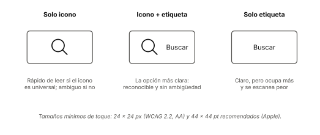

# Tema 6. Iconografía {#sec-tema6}

::: {.callout-note appearance="default"}
## Objetivos
- Diseñar o elegir un sistema de iconos coherente en estilo.
- Asegurar la legibilidad de los iconos a distintos tamaños.
- Aplicar criterios de neutralidad cultural y de género y de representación inclusiva.
:::

::: {.callout-note appearance="simple" icon="false"}
## Glosario del tema
[Icono](92-glosario.qmd#gl-icono) · [Sistema de iconos](92-glosario.qmd#gl-sistema-iconos) · [Rejilla de icono](92-glosario.qmd#gl-rejilla-icono) · [Distancia semántica](92-glosario.qmd#gl-distancia) · [Concreción](92-glosario.qmd#gl-concrecion) · [Nombre accesible](92-glosario.qmd#gl-nombre-accesible)
:::

::: {.callout-tip appearance="simple" icon="false"}
## Descargas
[Plantilla de entrega del reto (.qmd)](plantillas/entrega_reto.qmd){.btn .btn-outline-primary .btn-sm download="entrega_reto.qmd"}
[Tema de estilo (.scss)](plantillas/informe.scss){.btn .btn-outline-primary .btn-sm download="informe.scss"}
:::

## Lectura obligatoria

::: {.lectura}
McDougall, S. J. P.; Curry, M. B.; de Bruijn, O. (1999). [Measuring symbol and icon characteristics: Norms for concreteness, complexity, meaningfulness, familiarity, and semantic distance for 239 symbols](https://doi.org/10.3758/BF03200730). *Behavior Research Methods, Instruments, & Computers*, 31(3), 487-519.
:::

### Lecturas complementarias {.unnumbered}

- Material Design 3. [Icons](https://m3.material.io/styles/icons/overview). Un sistema de iconos documentado.
- Apple Human Interface Guidelines. [SF Symbols](https://developer.apple.com/design/human-interface-guidelines/sf-symbols). Iconos alineados con la tipografía.

## 1. Para qué sirve un icono

Un **icono** representa una acción, un objeto o un estado con una imagen pequeña. Ahorra espacio y, cuando es conocido, se reconoce más rápido que una palabra. Pero los iconos son mucho menos universales de lo que parecen: fuera de unos pocos muy asentados (casa, lupa, papelera, engranaje), la mayoría se entiende mal sin etiqueta.

McDougall, Curry y de Bruijn (1999) midieron cinco características de 239 símbolos: **concreción** (si representa un objeto reconocible), **complejidad** visual, **significatividad**, **familiaridad** y **distancia semántica** (cuánto se aleja la imagen de lo que significa). Los iconos concretos, familiares y con poca distancia semántica se entienden mejor; la familiaridad que da el uso puede compensar con el tiempo un icono abstracto.

**Regla práctica**: los iconos acompañan a una **etiqueta de texto**, salvo los universales en contextos muy conocidos. Si dudas, pon la etiqueta.

## 2. Coherencia de estilo

Un **sistema de iconos** comparte las mismas decisiones de estilo:

- **Rejilla y área de seguridad**: todos se dibujan en la misma rejilla (por ejemplo, 24 × 24 px con un margen interior).
- **Grosor de trazo** y **terminaciones** (redondeadas o rectas) iguales.
- **Relleno o contorno**: un estilo para el estado normal y, si se usa, el relleno para el estado seleccionado.
- **Nivel de detalle** y **perspectiva** iguales.
- **Ángulos y radios** de las esquinas comunes.

Mezclar iconos de bibliotecas distintas rompe la coherencia aunque cada uno sea correcto. Lo habitual es usar una biblioteca existente (Material Symbols, SF Symbols u otras de licencia libre) y dibujar solo los que falten con sus mismas reglas.

## 3. Legibilidad a distintos tamaños

- Los iconos se diseñan para tamaños concretos (16, 20, 24, 32 px…) y se comprueban a esos tamaños, no ampliados.
- A tamaños pequeños, los detalles finos desaparecen: se simplifica.
- El **área táctil** debe ser mayor que el icono: las WCAG 2.2 exigen al menos 24 × 24 px en el nivel AA, y las guías de plataforma recomiendan unos 44-48 px.
- Los iconos que transmiten información necesitan un contraste de **3:1** con el fondo (Tema 5).

## 4. Neutralidad cultural y de género, y representación inclusiva

- **Metáforas culturales**: el buzón, el cheque o el disquete no significan nada para muchas personas; la mano con el pulgar hacia arriba es ofensiva en algunos lugares. Hay que comprobar las metáforas con el público real.
- **Dirección**: las flechas de «siguiente» y «atrás» se invierten en idiomas que se escriben de derecha a izquierda.
- **Género**: para representar «persona» o «usuario», figuras neutras; si se representan personas, diversidad de géneros, edades, tonos de piel y capacidades. Evitar estereotipos (no asociar la cocina solo a mujeres o la herramienta solo a hombres).
- **Accesibilidad**: cada icono interactivo necesita un **nombre accesible** (lo que lee el lector de pantalla); los iconos decorativos se ocultan a las tecnologías de apoyo.

## Práctica

Busca diez iconos de la aplicación de tu banco o de tu universidad. Tápales la etiqueta y pide a dos personas que digan qué hacen. Anota cuántos aciertan y relaciona los fallos con la concreción y la distancia semántica de McDougall et al.

{#fig-t6-iconos fig-alt="Tres botones: uno solo con una lupa, otro con la lupa y la palabra Buscar, y otro solo con la palabra Buscar. Notas: solo icono, rápido si es universal y ambiguo si no; icono y etiqueta, la opción más clara; solo etiqueta, claro pero ocupa más. Abajo: tamaños mínimos de toque de 24 por 24 píxeles (WCAG 2.2, AA) y 44 por 44 puntos recomendados por Apple."}

## Caso práctico resuelto

::: {.callout-note appearance="simple" icon="false"}
## Un conjunto de iconos coherente
Revisión de los iconos de ReservaSala: el de «capacidad» es una persona en un estilo relleno, el de «ubicación» es de contorno con otro grosor y el de «enchufe» procede de una tercera colección. Resultado: la pantalla parece descuidada.

Corrección: una sola familia de iconos, mismo grosor de trazo (2 px), misma cuadrícula (24 × 24 px) y mismo estilo (contorno). Los iconos de función ambigua (por ejemplo, un engranaje para «preferencias de sala») llevan siempre una etiqueta de texto.
:::

## Ejercicios graduados

**Básico.** ¿Qué icono necesitaría siempre etiqueta: casa (inicio), lupa (buscar) o un rayo (enchufe disponible)?

::: {.webex-solution boton="Ver solución"}
El rayo: no tiene un significado convencional y podría interpretarse como «rápido» o «destacado». La casa y la lupa son convenciones muy asentadas, aunque una etiqueta sigue ayudando.
:::

**Avanzado.** Define las reglas de un sistema de iconos para la app (cuadrícula, trazo, esquinas, estados).

::: {.webex-solution boton="Ver solución"}
Cuadrícula de 24 px con zona segura de 2 px, trazo de 2 px, esquinas redondeadas de 2 px, versión rellena solo para el estado activo y tamaño táctil mínimo de 44 px alrededor.
:::

## Actividades

::: {.clasificar #ia-t6a-ambiguo titulo="¿Icono universal o ambiguo?" categorias="Bastante universal|Ambiguo: añade etiqueta"}
- Lupa para buscar → Bastante universal
- Casa para ir al inicio → Bastante universal
- Estrella: ¿favorito, valorar o destacado? → Ambiguo: añade etiqueta
- Corazón: ¿me gusta, guardar o salud? → Ambiguo: añade etiqueta
- Tres líneas horizontales para abrir el menú → Ambiguo: añade etiqueta // Muy extendido, pero no todo el mundo lo reconoce.
- Disquete para guardar → Ambiguo: añade etiqueta // Muchas personas jóvenes nunca han usado uno.
:::

::: {.clasificar #ia-t6a-coherencia titulo="¿Coherente o incoherente en un mismo set de iconos?" categorias="Coherente|Incoherente"}
- Todos con el mismo grosor de trazo → Coherente
- Unos rellenos y otros de contorno sin criterio → Incoherente
- Todos diseñados sobre la misma retícula de 24 px → Coherente
- Esquinas redondeadas en unos y rectas en otros → Incoherente
- El estado activo se marca siempre pasando de contorno a relleno → Coherente
:::

::: {.clasificar #ia-t6a-alt titulo="¿Qué texto alternativo necesita el icono?" categorias="Nombre de la acción|Vacío (decorativo)"}
- Botón con solo una lupa → Nombre de la acción // aria-label="Buscar".
- Lupa junto a la palabra «Buscar» dentro del mismo botón → Vacío (decorativo) // La etiqueta visible ya da el nombre.
- Papelera que borra un préstamo de la lista → Nombre de la acción
- Icono decorativo en un titular → Vacío (decorativo)
:::

## Reto evaluable {#reto-t6}

::: {.callout-important appearance="simple" icon="false"}
## Reto del Tema 6 · Sistema de iconos del proyecto
Para tu proyecto:

1. Haz el **inventario** de los iconos necesarios y decide cuáles llevan etiqueta y por qué.
2. Elige una **biblioteca** de iconos o define tu propio sistema (rejilla, trazo, terminaciones, relleno) y documenta las reglas.
3. Haz una prueba rápida de **comprensión** sin etiquetas con tres personas y analiza los resultados.
4. Revisa la **neutralidad** cultural y de género de los iconos y de las ilustraciones, y define el nombre accesible de cada icono interactivo.

**Entrega:** un informe hecho con la [plantilla de entrega](plantillas/entrega_reto.qmd). Se evalúa con la rúbrica que incluye la plantilla. Este reto **no tiene solución en el libro**: cada estudiante trabaja con un proyecto distinto y la corrección la hace el profesorado.
:::

## Autoevaluación

Responde a todas las preguntas y pulsa **Mostrar respuestas**: verás en verde las acertadas, en rojo las falladas y tu recuento. Puedes corregir y volver a comprobar. No cuenta para la nota.

::: {.webex-check .webex-box}
1. La mayoría de los iconos se entienden igual de bien sin etiqueta de texto. 
2. Cuánto se aleja la imagen de un icono de lo que significa se llama distancia 
3. Mezclar iconos de varias bibliotecas, aunque cada uno sea correcto, rompe la 
4. El tamaño mínimo del objetivo táctil en el nivel AA de las WCAG 2.2 es de 
5. ¿Qué necesita un botón que solo muestra un icono?



6. Las flechas de «siguiente» deben invertirse en las interfaces en idiomas que se escriben de derecha a izquierda. 
:::

::: {.webex-solution boton="Ver explicaciones"}
- Solo unos pocos iconos muy asentados son casi universales.
- Distancia semántica, una de las cinco características de McDougall et al.
- Grosores, terminaciones y detalles distintos se notan.
- Criterio 2.5.8 de las WCAG 2.2; las guías de plataforma recomiendan más.
- Sin nombre accesible, el lector de pantalla no puede decir qué hace.
- La dirección de lectura cambia el sentido de «adelante» y «atrás».
:::

## Recursos complementarios

| Recurso | Para qué sirve |
|---|---|
| [Material Design 3 – Icons](https://m3.material.io/styles/icons/overview) | Sistema de iconos y reglas |
| [Apple – SF Symbols](https://developer.apple.com/design/human-interface-guidelines/sf-symbols) | Iconos alineados con el texto |
| [Nielsen Norman Group – Icon usability](https://www.nngroup.com/articles/icon-usability/) | Investigación sobre iconos y etiquetas |
| [W3C – Understanding SC 2.5.8: Target size (minimum)](https://www.w3.org/WAI/WCAG22/Understanding/target-size-minimum.html) | Tamaño de los objetivos |
