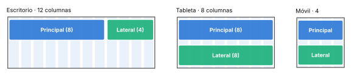
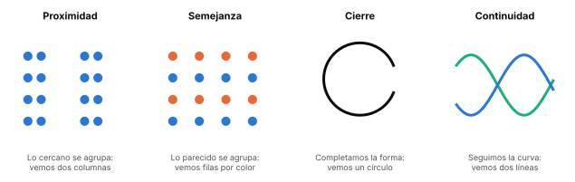

# Tema 7. Composición y proporción en pantalla {#sec-tema7}

::: {.callout-note appearance="default"}
## Objetivos
- Organizar la pantalla con rejillas, proporciones y estructura modular.
- Conseguir equilibrio visual y ritmo.
- Adaptar la composición a distintos tamaños de pantalla.
:::

::: {.callout-note appearance="simple" icon="false"}
## Glosario del tema
[Rejilla](92-glosario.qmd#gl-rejilla) · [Proporción](92-glosario.qmd#gl-proporcion) · [Equilibrio visual](92-glosario.qmd#gl-equilibrio) · [Ritmo](92-glosario.qmd#gl-ritmo) · [Estética clásica y expresiva](92-glosario.qmd#gl-clasica) · [Diseño adaptable](92-glosario.qmd#gl-adaptable) · [Punto de ruptura](92-glosario.qmd#gl-ruptura)
:::

::: {.callout-tip appearance="simple" icon="false"}
## Descargas
[Script R del capítulo](plantillas/07_composicion.R){.btn .btn-outline-primary .btn-sm download="07_composicion.R"}
[Plantilla de entrega del reto (.qmd)](plantillas/entrega_reto.qmd){.btn .btn-outline-primary .btn-sm download="entrega_reto.qmd"}
[Tema de estilo (.scss)](plantillas/informe.scss){.btn .btn-outline-primary .btn-sm download="informe.scss"}
:::

## Lectura obligatoria

::: {.lectura}
Lavie, T.; Tractinsky, N. (2004). [Assessing dimensions of perceived visual aesthetics of web sites](https://doi.org/10.1016/j.ijhcs.2003.09.002). *International Journal of Human-Computer Studies*, 60(3), 269-298.
:::

### Lecturas complementarias {.unnumbered}

- Lidwell, W.; Holden, K.; Butler, J. (2011). *Principios universales de diseño*. Blume. Entradas sobre alineación, proximidad, simetría y proporción áurea.
- Nielsen Norman Group. [Using grids in interface designs](https://www.nngroup.com/articles/using-grids-in-interface-designs/). Rejillas en interfaces.

## 1. Qué hace que una composición funcione

Lavie y Tractinsky (2004) estudiaron cómo perciben las personas la estética de los sitios web y encontraron dos dimensiones: la **estética clásica** (orden, claridad, limpieza, simetría) y la **estética expresiva** (creatividad, originalidad, sofisticación). La composición trabaja sobre todo la primera: una interfaz ordenada se percibe como clara y fácil. La segunda depende de la identidad visual y conviene dosificarla donde no estorbe a la tarea.

## 2. Rejillas

La **rejilla** de columnas (ya introducida en baja fidelidad) es la herramienta principal de la composición en alta fidelidad. Además de columnas, medianiles y márgenes, se usa:

- Una **unidad base** de espaciado (por ejemplo, 4 u 8 px) de la que derivan todos los espacios: 8, 16, 24, 32, 48…
- Una **rejilla de base** horizontal que alinea las líneas de texto, útil en pantallas con mucho texto.
- **Zonas** o módulos: bloques que ocupan un número entero de columnas.

## 3. Proporción, equilibrio y ritmo

- **Proporción**: relaciones de tamaño entre elementos. Proporciones simples (1:2, 2:3, 1:3) o la escala modular de la tipografía (Tema 4) dan coherencia. La proporción áurea (1:1,618) es una opción más, no una ley.
- **Equilibrio**: el «peso visual» (tamaño, color, contraste, densidad) se reparte de forma simétrica o asimétrica pero compensada. Una pantalla desequilibrada transmite descuido.
- **Ritmo**: la repetición regular de elementos y espacios (tarjetas iguales, separaciones iguales) permite anticipar la estructura y leer más deprisa.
- **Alineación**: cada elemento alineado con algo. Los ejes de alineación pocos y claros.

## 4. Estructura modular y diseño adaptable

Los productos se usan en pantallas de tamaños muy distintos. El **diseño adaptable** (*responsive*) define cómo se reorganiza la composición en cada **punto de ruptura** (por ejemplo, 600 y 1024 px): de 12 a 8 y a 4 columnas, apilando módulos y cambiando la navegación. Una estructura **modular** facilita esa reorganización: los módulos se mueven, no se rediseñan.

Las WCAG exigen que el contenido se pueda ver sin desplazamiento horizontal a una anchura equivalente a 320 px (criterio de **reajuste**, o *reflow*), lo que asegura que la página siga siendo usable con un zum del 400 %.

{#fig-adaptable fig-alt="Tres rectángulos que representan pantallas de escritorio (12 columnas), tableta (8 columnas) y móvil (4 columnas). En escritorio, un módulo principal de 8 columnas y uno lateral de 4 están en la misma fila. En tableta, el principal ocupa 8 columnas y el lateral pasa debajo. En móvil, los dos ocupan las 4 columnas, uno debajo del otro."}

## Práctica en R: medidas de la composición

```{webr}
#| autorun: true
source("datos/funciones_ux.R")
attr(rejilla(1440, 12, 24, 80), "ancho_columna")
ancho_bloque(8, 1440, 12, 24, 80)   # módulo principal
ancho_bloque(4, 1440, 12, 24, 80)   # lateral
```

### Ejercicio 7.1 {.unnumbered}

En tableta (1024 px, 8 columnas, medianil de 24 px y margen de 32 px), ¿cuánto mide un módulo que ocupa **todas** las columnas?

```{webr}
#| exercise: t7_tableta
#| setup: true
source("datos/funciones_ux.R")
```

```{webr}
#| exercise: t7_tableta
ancho_bloque(n = ______, ancho = 1024, columnas = 8, medianil = 24, margen = 32)
```

::: {.hint exercise="t7_tableta"}
Ocupa todas las columnas de la rejilla de tableta: 8.
:::

::: {.solution exercise="t7_tableta"}
```r
ancho_bloque(n = 8, ancho = 1024, columnas = 8, medianil = 24, margen = 32)
```
960 px: el ancho total menos los dos márgenes (1024 − 64).
:::

```{webr}
#| exercise: t7_tableta
#| check: true
if (isTRUE(all.equal(as.numeric(.result), 960))) {
  list(correct = TRUE, message = "Correcto: 960 px, el ancho menos los márgenes.")
} else {
  list(correct = FALSE, message = "El módulo ocupa las 8 columnas.")
}
```

{#fig-t7-gestalt fig-alt="Cuatro paneles. Proximidad: puntos separados en dos bloques que se ven como dos columnas. Semejanza: filas alternas de puntos naranjas y azules que se ven como filas. Cierre: un círculo con un hueco que se percibe completo. Continuidad: dos curvas que se cruzan y se ven como dos líneas."}

## Laboratorio: proximidad {#lab-t7-proximidad}

::: {.laboratorio}
::: {.laboratorio-etiqueta}
Laboratorio · se ejecuta en tu navegador
:::

Cambia el espacio horizontal y vertical entre los puntos. Cuando los puntos están más cerca en vertical que en horizontal, ves **columnas**; cuando están más cerca en horizontal, ves **filas**. Es el principio que hace que una etiqueta «pertenezca» a su campo si está más cerca de él que del siguiente.

```{ojs}
//| echo: false
rango = window.Lab.rango
viewof g_h = rango("Espacio horizontal", [10, 60], {step: 2, value: 40})
viewof g_v = rango("Espacio vertical", [10, 60], {step: 2, value: 16})
```

```{ojs}
//| echo: false
{
  const pts = []; for (let i = 0; i < 5; i++) for (let j = 0; j < 6; j++) pts.push(`<circle cx="${20 + j * g_h}" cy="${20 + i * g_v}" r="6" fill="#2a78d6"/>`);
  const w = 40 + 5 * g_h, h = 40 + 4 * g_v;
  const d = html`<div role="status"></div>`;
  d.innerHTML = `<svg viewBox="0 0 ${w} ${h}" width="${w}" height="${h}" style="max-width:100%" role="img" aria-label="Seis columnas y cinco filas de puntos">${pts.join("")}</svg>
   <p>Lo más probable es que veas <strong>${g_h > g_v * 1.3 ? "columnas" : g_v > g_h * 1.3 ? "filas" : "una retícula sin grupos claros"}</strong>.</p>`;
  return d;
}
```
:::

## Laboratorio: de la rejilla al diseño adaptable {#lab-t7-adaptable}

::: {.laboratorio}
::: {.laboratorio-etiqueta}
Laboratorio · se ejecuta en tu navegador
:::

Mueve el ancho de la ventana y mira cómo se reorganizan seis tarjetas según tres **puntos de ruptura** (600 y 1024 px).

```{ojs}
//| echo: false
viewof a_ancho = rango("Ancho de la ventana (px)", [320, 1440], {step: 8, value: 800})
```

```{ojs}
//| echo: false
{
  const cols = a_ancho < 600 ? 1 : a_ancho < 1024 ? 2 : 3;
  const nombre = cols === 1 ? "móvil: 1 columna" : cols === 2 ? "tableta: 2 columnas" : "escritorio: 3 columnas";
  const esc = Math.min(1, 640 / a_ancho), w = a_ancho * esc, pad = 16 * esc, gap = 12 * esc;
  const cw = (w - 2 * pad - (cols - 1) * gap) / cols, ch = 70 * Math.max(esc, .55);
  const r = []; for (let k = 0; k < 6; k++) { const c = k % cols, f = Math.floor(k / cols);
    r.push(`<rect x="${pad + c * (cw + gap)}" y="${pad + f * (ch + gap)}" width="${cw}" height="${ch}" rx="6" fill="#dbe8f8" stroke="#2a78d6"/><text x="${pad + c * (cw + gap) + 8}" y="${pad + f * (ch + gap) + 20}" font-size="12" fill="#0b0b0b">Sala ${k + 1}</text>`); }
  const h = 2 * pad + Math.ceil(6 / cols) * (ch + gap);
  const d = html`<div role="status"></div>`;
  d.innerHTML = `<p><strong>${a_ancho} px</strong> → ${nombre}</p><svg viewBox="0 0 ${w} ${h}" width="${w}" style="max-width:100%;border:1px solid var(--bs-border-color);border-radius:8px;background:#fff" role="img" aria-label="${nombre}">${r.join("")}</svg>`;
  return d;
}
```
:::

## Actividades

::: {.clasificar #ia-t7a-gestalt titulo="¿Qué principio de la Gestalt se aplica?" categorias="Proximidad|Semejanza|Cierre|Continuidad|Región común"}
- La etiqueta está más cerca de su campo que del campo anterior → Proximidad
- Todos los enlaces tienen el mismo color y subrayado → Semejanza
- Un carrusel deja ver media tarjeta en el borde para invitar a desplazarse → Continuidad
- Un logotipo formado por trazos que no llegan a tocarse → Cierre
- Varios elementos dentro de una misma tarjeta con fondo → Región común
:::

::: {.clasificar #ia-t7a-rejilla titulo="¿Qué rejilla usarías?" categorias="Una columna|Varias columnas|Modular|Jerárquica"}
- Un artículo largo para leer en móvil → Una columna
- Un periódico digital con varias secciones a la vez → Varias columnas
- Un catálogo de libros con portadas del mismo tamaño → Modular
- Una portada con una noticia destacada y otras más pequeñas, sin patrón regular → Jerárquica
:::

## Reto evaluable {#reto-t7}

::: {.callout-important appearance="simple" icon="false"}
## Reto del Tema 7 · Composición adaptable
Para tu proyecto:

1. Define la **rejilla** de escritorio, tableta y móvil (columnas, medianiles, márgenes, puntos de ruptura) y la **unidad base** de espaciado.
2. Compón la pantalla principal en los **tres tamaños**, mostrando la rejilla, y explica cómo se reorganizan los módulos.
3. Analiza su **equilibrio** y su **ritmo** y justifica las proporciones elegidas.
4. Comprueba el criterio de **reajuste** a 320 px.

**Entrega:** un informe hecho con la [plantilla de entrega](plantillas/entrega_reto.qmd). Se evalúa con la rúbrica que incluye la plantilla. Este reto **no tiene solución en el libro**: cada estudiante trabaja con un proyecto distinto y la corrección la hace el profesorado.
:::

## Autoevaluación

Responde a todas las preguntas y pulsa **Mostrar respuestas**: verás en verde las acertadas, en rojo las falladas y tu recuento. Puedes corregir y volver a comprobar. No cuenta para la nota.

::: {.webex-check .webex-box}
1. Lavie y Tractinsky distinguen una estética clásica y otra 
2. Con una unidad base de 8 px, un espacio de 20 px es coherente con el sistema. 
3. La proporción áurea es una ley que toda composición debe cumplir. 
4. El criterio de las WCAG que exige ver el contenido sin desplazamiento horizontal a 320 px de ancho se llama 
5. ¿Qué facilita una estructura modular en el diseño adaptable?



6. La repetición regular de elementos y espacios que permite anticipar la estructura se llama 
:::

::: {.webex-solution boton="Ver explicaciones"}
- Clásica (orden, claridad) y expresiva (creatividad, originalidad).
- 20 no es múltiplo de 8; sí lo serían 16 o 24.
- Es una opción de proporción, no una obligación.
- Reajuste (*reflow*), criterio 1.4.10.
- Los módulos se mueven y apilan; no hay que rediseñarlos.
- El ritmo nace de la repetición regular.
:::

## Recursos complementarios

| Recurso | Para qué sirve |
|---|---|
| [Material Design 3 – Layout](https://m3.material.io/foundations/layout) | Rejillas y puntos de ruptura |
| [W3C – Understanding SC 1.4.10: Reflow](https://www.w3.org/WAI/WCAG22/Understanding/reflow.html) | Reajuste a 320 px |
| [Nielsen Norman Group – Using grids](https://www.nngroup.com/articles/using-grids-in-interface-designs/) | Rejillas en interfaces |
