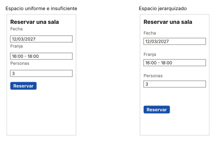

# Tema 8. Espacio negativo y respiración visual {#sec-tema8}

::: {.callout-note appearance="default"}
## Objetivos
- Entender el papel del espacio en blanco en la legibilidad, la jerarquía y la calidad percibida.
- Distinguir el macroespacio y el microespacio, y usar ambos.
- Equilibrar la densidad de información con la respiración visual.
:::

::: {.callout-note appearance="simple" icon="false"}
## Glosario del tema
[Espacio negativo](92-glosario.qmd#gl-espacio) · [Macroespacio](92-glosario.qmd#gl-macro) · [Microespacio](92-glosario.qmd#gl-micro) · [Complejidad visual](92-glosario.qmd#gl-complejidad) · [Densidad de información](92-glosario.qmd#gl-densidad) · [Proximidad](92-glosario.qmd#gl-proximidad)
:::

::: {.callout-tip appearance="simple" icon="false"}
## Descargas
[Plantilla de entrega del reto (.qmd)](plantillas/entrega_reto.qmd){.btn .btn-outline-primary .btn-sm download="entrega_reto.qmd"}
[Tema de estilo (.scss)](plantillas/informe.scss){.btn .btn-outline-primary .btn-sm download="informe.scss"}
:::

## Lectura obligatoria

::: {.lectura}
Tuch, A. N.; Presslaber, E. E.; Stöcklin, M.; Opwis, K.; Bargas-Avila, J. A. (2012). [The role of visual complexity and prototypicality regarding first impression of websites: Working towards understanding aesthetic judgments](https://doi.org/10.1016/j.ijhcs.2012.06.003). *International Journal of Human-Computer Studies*, 70(11), 794-811.
:::

### Lecturas complementarias {.unnumbered}

- Lindgaard, G. et al. (2006). [Attention web designers: You have 50 milliseconds to make a good first impression!](https://doi.org/10.1080/01449290500330448) *Behaviour & Information Technology*, 25(2), 115-126.
- Lidwell, W.; Holden, K.; Butler, J. (2011). *Principios universales de diseño*. Blume. Entradas sobre la proximidad y la relación figura-fondo.

## 1. El espacio no es lo que sobra

El **espacio negativo** (o espacio en blanco, aunque no sea blanco) es la parte de la composición que no ocupa ningún elemento. No es espacio desperdiciado: separa, agrupa, da ritmo, dirige la mirada y transmite calma y calidad. Tuch et al. (2012) mostraron que las páginas con **baja complejidad visual** causan mejor primera impresión, y el espacio es la herramienta más directa para reducir esa complejidad sin quitar contenido.

## 2. Macroespacio y microespacio

| Escala | Qué es | Qué consigue |
|---|---|---|
| **Macroespacio** | Márgenes de la página, separación entre secciones y módulos, espacio alrededor de la acción principal | Estructura, jerarquía, foco |
| **Microespacio** | Interlineado, espacio entre letras y palabras, relleno interior de botones y campos, separación entre una etiqueta y su campo | Legibilidad, agrupación fina, comodidad de uso |

Los dos se derivan de la misma **unidad base** (Tema 7) para que el sistema sea coherente.

## 3. Espacio y jerarquía

- **Proximidad**: lo que está cerca se percibe como un grupo. La etiqueta debe estar más cerca de su campo que del campo anterior; el título de una sección, más cerca de su contenido que de la sección anterior.
- **Aislamiento**: un elemento rodeado de espacio destaca. La acción principal no necesita ser enorme si tiene espacio alrededor.
- **Respiración**: un bloque de texto con márgenes generosos se lee mejor que el mismo texto encajado.

{#fig-espacio fig-alt="Dos versiones de un mismo formulario de reserva. A la izquierda, todos los elementos están separados por la misma distancia corta y las etiquetas quedan a medio camino entre dos campos. A la derecha, cada etiqueta está pegada a su campo, hay más espacio entre los grupos y el botón Reservar tiene espacio a su alrededor."}

## 4. Densidad de información

No todas las interfaces deben tener mucho espacio. Una herramienta profesional que se usa durante horas (un sistema de catalogación, un panel de datos) necesita más **densidad de información** que una web pública que se visita una vez. El objetivo no es «más blanco», sino el espacio adecuado a la tarea y a la frecuencia de uso. Muchos sistemas de diseño ofrecen por eso varias **densidades** (cómoda, compacta) de los mismos componentes.

Un riesgo frecuente es esconder información necesaria para «ganar» espacio: obligar a abrir menús o pestañas para ver lo que la persona necesita en cada momento. El espacio debe servir a la tarea, no a la estética.

## Práctica

Toma la captura de una pantalla densa de un servicio que uses. Sin quitar ningún contenido, redistribuye el espacio: agrupa por proximidad, separa las secciones y aísla la acción principal. Compara la primera impresión de las dos versiones con otra persona.

## Reto evaluable {#reto-t8}

::: {.callout-important appearance="simple" icon="false"}
## Reto del Tema 8 · Sistema de espaciado
Para tu proyecto:

1. Define la **escala de espaciado** a partir de la unidad base (al menos seis valores) y el uso de cada uno (macro y micro).
2. Aplica la escala a la pantalla más densa del proyecto y muestra el antes y el después.
3. Justifica la **densidad** elegida según la tarea y la frecuencia de uso.
4. Comprueba que el espaciado sigue funcionando con el **espaciado de texto ampliado** de las WCAG (criterio 1.4.12).

**Entrega:** un informe hecho con la [plantilla de entrega](plantillas/entrega_reto.qmd). Se evalúa con la rúbrica que incluye la plantilla. Este reto **no tiene solución en el libro**: cada estudiante trabaja con un proyecto distinto y la corrección la hace el profesorado.
:::

## Autoevaluación

Responde a todas las preguntas y pulsa **Mostrar respuestas**: verás en verde las acertadas, en rojo las falladas y tu recuento. Puedes corregir y volver a comprobar. No cuenta para la nota.

::: {.webex-check .webex-box}
1. El espacio negativo es espacio desperdiciado que conviene reducir al mínimo. 
2. El relleno interior de un botón es un ejemplo de 
3. Según Tuch et al., las páginas con complejidad visual baja causan mejor primera impresión. 
4. La etiqueta de un campo debe estar más cerca de 
5. ¿Qué interfaz necesita probablemente más densidad de información?



6. Un elemento rodeado de espacio destaca aunque no sea grande: es el principio de 
:::

::: {.webex-solution boton="Ver explicaciones"}
- Separa, agrupa, da ritmo y dirige la mirada.
- Es espacio a escala fina, dentro del componente.
- Y el espacio es la forma más directa de reducirla.
- Ley de proximidad: lo cercano se percibe como relacionado.
- El uso intensivo y experto justifica más densidad.
- El aislamiento destaca sin necesidad de aumentar el tamaño.
:::

## Recursos complementarios

| Recurso | Para qué sirve |
|---|---|
| [Material Design 3 – Spacing](https://m3.material.io/foundations/layout/understanding-layout/spacing) | Escala de espaciado de un sistema |
| [Nielsen Norman Group – Proximity principle](https://www.nngroup.com/articles/gestalt-proximity/) | La ley de proximidad en interfaces |
| [W3C – Understanding SC 1.4.12: Text spacing](https://www.w3.org/WAI/WCAG22/Understanding/text-spacing.html) | Espaciado de texto ampliado |
