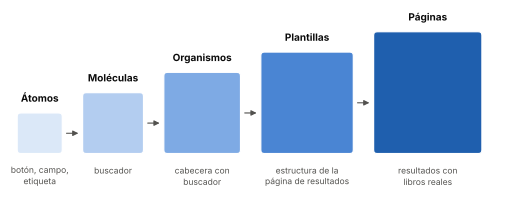
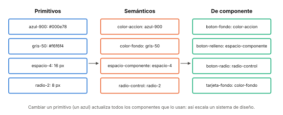

# Tema 9. Bibliotecas y sistemas de diseño {#sec-tema9}

::: {.callout-note appearance="default"}
## Objetivos
- Conocer los principales sistemas de diseño y su estructura.
- Construir y usar bibliotecas de componentes y *tokens* de diseño.
- Entender la gobernanza de un sistema de diseño.
:::

::: {.callout-note appearance="simple" icon="false"}
## Glosario del tema
[Sistema de diseño](92-glosario.qmd#gl-sistema) · [Biblioteca de componentes](92-glosario.qmd#gl-biblioteca) · [Token de diseño](92-glosario.qmd#gl-token) · [Diseño atómico](92-glosario.qmd#gl-atomico) · [Variante](92-glosario.qmd#gl-variante) · [Gobernanza](92-glosario.qmd#gl-gobernanza)
:::

::: {.callout-tip appearance="simple" icon="false"}
## Descargas
[Plantilla de entrega del reto (.qmd)](plantillas/entrega_reto.qmd){.btn .btn-outline-primary .btn-sm download="entrega_reto.qmd"}
[Tema de estilo (.scss)](plantillas/informe.scss){.btn .btn-outline-primary .btn-sm download="informe.scss"}
:::

## Lectura obligatoria

::: {.lectura}
Frost, B. (2016). [*Atomic design*](https://atomicdesign.bradfrost.com/). Libro en abierto: capítulos 1 y 2.
:::

### Lecturas complementarias {.unnumbered}

- Churchill, E. F. (2019). [Scaling UX with design systems](https://doi.org/10.1145/3352681). *Interactions*, 26(5), 22-23. Los sistemas de diseño como infraestructura de la organización.
- Material Design 3 y [Apple Human Interface Guidelines](https://developer.apple.com/design/human-interface-guidelines/): dos sistemas de plataforma de referencia.

## 1. Qué es un sistema de diseño

Un **sistema de diseño** es el conjunto de principios, estilos, componentes reutilizables, patrones y documentación con el que una organización diseña y construye sus productos de forma coherente. No es solo una biblioteca de Figma: incluye el **código** de los componentes y las **reglas** de uso. Churchill (2019) lo describe como la forma de que la experiencia de usuario **escale** cuando muchos equipos trabajan a la vez.

Sus beneficios: **coherencia** entre productos y pantallas, **eficiencia** (no se diseña dos veces lo mismo), **calidad** (cada componente se prueba una vez, también en accesibilidad) y un **lenguaje común** entre diseño y desarrollo.

## 2. Estructura: *tokens*, componentes y patrones

| Capa | Qué contiene | Ejemplo |
|---|---|---|
| **Principios** | Valores que orientan las decisiones | «Claro antes que ingenioso» |
| ***Tokens* de diseño** | Decisiones de estilo con nombre, independientes de la herramienta | `color.accion.primaria = #174ea6`, `espacio.3 = 16px` |
| **Componentes** | Piezas reutilizables con sus variantes y estados | Botón (primario, secundario; reposo, foco, desactivado) |
| **Patrones** | Combinaciones de componentes para tareas frecuentes | Formulario de reserva, búsqueda con filtros |
| **Documentación** | Cuándo usar cada cosa, cuándo no, accesibilidad, ejemplos | Página del componente «Botón» |

Los ***tokens*** separan el valor (un color concreto) de su función (la acción primaria). Si cambia la marca, se cambia el valor del *token* y se actualiza todo; si hay un modo oscuro, el mismo *token* tiene otro valor.

## 3. Diseño atómico

Frost (2016) propone construir las interfaces de abajo arriba en cinco niveles, con una metáfora química:

1. **Átomos**: los elementos mínimos (una etiqueta, un campo, un botón).
2. **Moléculas**: grupos sencillos con una función (un buscador: etiqueta, campo y botón).
3. **Organismos**: secciones complejas (una cabecera con logotipo, navegación y buscador).
4. **Plantillas**: la estructura de una página con los organismos colocados.
5. **Páginas**: las plantillas con contenido real, donde se comprueba que todo funciona.

{#fig-atomico fig-alt="Cinco columnas de izquierda a derecha, cada una más grande que la anterior: átomos (un botón, un campo, una etiqueta), moléculas (un buscador), organismos (una cabecera con buscador), plantillas (la estructura de la página de resultados) y páginas (la página de resultados con libros reales)."}

## 4. Sistemas de referencia

- **Material Design 3** (Google): componentes, color dinámico, *tokens* y guías de accesibilidad.
- **Human Interface Guidelines** (Apple): principios y componentes de sus plataformas.
- Sistemas públicos con código abierto, como el **GOV.UK Design System** (Reino Unido) o el **U.S. Web Design System**, especialmente cuidadosos con la accesibilidad.

Diseñar para una plataforma implica respetar sus convenciones: lo que la persona ya conoce de su sistema operativo.

## 5. Gobernanza

Un sistema de diseño necesita **gobernanza**: quién decide qué entra, cómo se proponen cambios, cómo se versiona y cómo se comunica a los equipos. Sin ella, el sistema se fragmenta (cada equipo crea su propio botón) o se congela (nadie se atreve a cambiar nada). Los modelos habituales son el **centralizado** (un equipo dedicado), el **federado** (representantes de varios equipos) o una combinación.

## Práctica

Elige un componente de Material Design 3 y otro del GOV.UK Design System (por ejemplo, el botón). Compara su documentación: variantes, estados, reglas de uso y accesibilidad. ¿Qué incluye uno que no incluya el otro?

{#fig-t9-tokens fig-alt="Tres columnas de recuadros conectadas por flechas. Primitivos: azul-900 #000e78, gris-50 #f6f6f4, espacio-4 16 px, radio-2 8 px. Semánticos: color-accion apunta a azul-900, color-fondo a gris-50, espacio-componente a espacio-4, radio-control a radio-2. De componente: boton-fondo apunta a color-accion, boton-relleno a espacio-componente, boton-radio a radio-control, tarjeta-fondo a color-fondo."}

## Laboratorio: explorador de *tokens* {#lab-t9-tokens}

::: {.laboratorio}
::: {.laboratorio-etiqueta}
Laboratorio · se ejecuta en tu navegador
:::

Edita los *tokens* (en JSON) y pulsa **Aplicar**: la tarjeta y el botón cambian a la vez, porque leen los mismos valores. El laboratorio comprueba además el contraste entre el texto del botón y su fondo.

```{ojs}
//| echo: false
area = window.Lab.area
viewof tokens_txt = area("Tokens (JSON)", {rows: 9, submit: "Aplicar", value: `{
  "color-accion": "#000e78",
  "color-sobre-accion": "#ffffff",
  "color-fondo": "#f6f6f4",
  "color-texto": "#1c1c1c",
  "espacio": 16,
  "radio": 8,
  "tamano-texto": 16
}`})
```

```{ojs}
//| echo: false
{
  let t; try { t = JSON.parse(tokens_txt); } catch (e) { return html`<p role="status" class="lab-mal">El JSON no es válido: ${e.message}</p>`; }
  const lin = c => c <= 0.04045 ? c / 12.92 : Math.pow((c + 0.055) / 1.055, 2.4);
  const L = h => { const v = [1, 3, 5].map(i => lin(parseInt(String(h).slice(i, i + 2), 16) / 255)); return 0.2126 * v[0] + 0.7152 * v[1] + 0.0722 * v[2]; };
  const ratio = (a, b) => { const [x, y] = [L(a), L(b)].sort((p, q) => q - p); return (x + 0.05) / (y + 0.05); };
  const ok = /^#[0-9a-f]{6}$/i;
  for (const k of ["color-accion", "color-sobre-accion", "color-fondo", "color-texto"]) if (!ok.test(t[k] || "")) return html`<p role="status" class="lab-mal">Falta «${k}» o no es un color #rrggbb.</p>`;
  const rb = ratio(t["color-accion"], t["color-sobre-accion"]), rt = ratio(t["color-texto"], t["color-fondo"]);
  const e = +t["espacio"] || 16, r = +t["radio"] || 0, f = +t["tamano-texto"] || 16;
  const d = html`<div role="status"></div>`;
  d.innerHTML = `<div style="background:${t["color-fondo"]};color:${t["color-texto"]};padding:${e}px;border-radius:${r}px;max-width:22rem;font-size:${f}px;border:1px solid #ccc">
    <div style="font-weight:600;font-size:${f * 1.25}px;margin-bottom:${e / 2}px">Sala de estudio 2</div>
    <div style="margin-bottom:${e}px">Libre de 10:00 a 13:00</div>
    <span style="display:inline-block;background:${t["color-accion"]};color:${t["color-sobre-accion"]};padding:${e / 2}px ${e}px;border-radius:${r}px;font-weight:600">Reservar</span></div>
   <p class="mt-2">Botón: <strong>${rb.toFixed(2).replace(".", ",")}:1</strong> <span class="${rb >= 4.5 ? "lab-bien" : "lab-mal"}" style="font-weight:600">${rb >= 4.5 ? "✓ AA" : "✗ no llega a 4,5:1"}</span> ·
   Texto: <strong>${rt.toFixed(2).replace(".", ",")}:1</strong> <span class="${rt >= 4.5 ? "lab-bien" : "lab-mal"}" style="font-weight:600">${rt >= 4.5 ? "✓ AA" : "✗ no llega a 4,5:1"}</span></p>`;
  return d;
}
```

**Prueba:** cambia `color-accion` a `#2a78d6`. El botón sigue siendo legible con texto blanco, pero ¿cumple 4,5:1?
:::

## Caso práctico resuelto

::: {.callout-note appearance="simple" icon="false"}
## Del diseño suelto a un sistema
En la tercera iteración hay cuatro variantes del botón principal con radios y alturas distintas. Se crea un sistema mínimo:

- **Tokens:** `color.primario`, `color.exito`, `espacio.2` (16 px), `radio.m` (8 px), `fuente.texto` (16 px).
- **Componentes:** botón (primario, secundario, texto; estados normal, foco, desactivado, cargando), fila de sala, barra de disponibilidad, tarjeta de reserva.
- **Documentación:** cuándo usar cada variante, accesibilidad (foco visible, contraste) y ejemplos de uso incorrecto.

Al cambiar un token (por ejemplo, el color primario para adaptarlo a la marca de la universidad), todas las pantallas se actualizan de forma coherente.
:::

## Ejercicios graduados

**Básico.** ¿Qué estados mínimos debe documentar un botón?

::: {.webex-solution boton="Ver solución"}
Normal, *hover* (en escritorio), foco (visible para teclado), pulsado, desactivado y cargando. Cada uno con su especificación de color y contraste.
:::

**Avanzado.** Define los tokens de color de ReservaSala en modo claro y oscuro con nombres semánticos.

::: {.webex-solution boton="Ver solución"}
Nombres por función (`fondo`, `superficie`, `texto`, `texto-secundario`, `primario`, `exito`, `error`, `borde`), no por color («verde»), con valores para cada modo y contraste comprobado en ambos.
:::


## Actividades

::: {.ordenar #ia-t9a-atomico titulo="Los niveles del diseño atómico (Frost, 2016), de menor a mayor"}
1. Átomos (un botón, una etiqueta)
2. Moléculas (un campo de búsqueda con su botón)
3. Organismos (una cabecera completa)
4. Plantillas (la estructura de una página)
5. Páginas (la plantilla con contenido real)
:::

::: {.clasificar #ia-t9a-capa titulo="¿Qué capa de token es?" categorias="Primitivo|Semántico|De componente"}
- `azul-900: #000e78` → Primitivo
- `color-error: rojo-700` → Semántico
- `boton-primario-fondo: color-accion` → De componente
- `espacio-8: 32px` → Primitivo
- `color-texto-secundario: gris-700` → Semántico
- `tarjeta-sombra: sombra-2` → De componente
:::

::: {.clasificar #ia-t9a-gobernanza titulo="¿Buena gobernanza del sistema?" categorias="Sí|No"}
- Un registro de cambios con versiones semánticas → Sí
- Cada equipo crea su propio botón «porque es un caso especial» → No
- Un canal para proponer componentes nuevos y criterios para aceptarlos → Sí
- La documentación solo vive en la cabeza de quien creó el sistema → No
:::

## Reto evaluable {#reto-t9}

::: {.callout-important appearance="simple" icon="false"}
## Reto del Tema 9 · Mini sistema de diseño
Para tu proyecto:

1. Define los ***tokens*** de color, tipografía y espaciado a partir de los retos de los temas 4, 5 y 8, con nombres funcionales.
2. Construye en tu herramienta de diseño una **biblioteca** con al menos seis componentes, cada uno con sus variantes y estados (reposo, foco, desactivado, error).
3. Organiza la biblioteca con los niveles del **diseño atómico** y documenta dos componentes (uso, no uso, accesibilidad).
4. Propón una regla de **gobernanza** sencilla para el equipo del proyecto final.

**Entrega:** un informe hecho con la [plantilla de entrega](plantillas/entrega_reto.qmd) con el enlace a la biblioteca. Se evalúa con la rúbrica que incluye la plantilla. Este reto **no tiene solución en el libro**: cada estudiante trabaja con un proyecto distinto y la corrección la hace el profesorado.
:::

## Autoevaluación

Responde a todas las preguntas y pulsa **Mostrar respuestas**: verás en verde las acertadas, en rojo las falladas y tu recuento. Puedes corregir y volver a comprobar. No cuenta para la nota.

::: {.webex-check .webex-box}
1. Un sistema de diseño es solo una biblioteca de componentes en la herramienta de diseño. 
2. Una decisión de estilo con nombre funcional, como `color.accion.primaria`, es un 
3. En el diseño atómico, un buscador formado por etiqueta, campo y botón es 
4. Los *tokens* facilitan crear un modo oscuro cambiando sus valores sin rediseñar los componentes. 
5. ¿Qué ocurre si un sistema de diseño no tiene gobernanza?



6. ¿En qué nivel del diseño atómico se comprueba que todo funciona con el contenido real? 
:::

::: {.webex-solution boton="Ver explicaciones"}
- Incluye también principios, código, patrones y documentación.
- Un *token* separa el valor de su función.
- Una molécula combina átomos con una función sencilla.
- El mismo *token* toma otro valor en el modo oscuro.
- Sin reglas de cambio, cada equipo hace lo suyo o nadie cambia nada.
- Las páginas son las plantillas con contenido real.
:::

## Recursos complementarios

| Recurso | Para qué sirve |
|---|---|
| [Frost, B. – Atomic design](https://atomicdesign.bradfrost.com/) | El libro completo, en abierto |
| [Material Design 3](https://m3.material.io/) | Sistema de Google |
| [Apple Human Interface Guidelines](https://developer.apple.com/design/human-interface-guidelines/) | Guías de Apple |
| [GOV.UK Design System](https://design-system.service.gov.uk/) | Sistema público con foco en accesibilidad |
| [U.S. Web Design System](https://designsystem.digital.gov/) | Sistema público de Estados Unidos |
| [Figma Community](https://www.figma.com/community) | Bibliotecas y kits |
