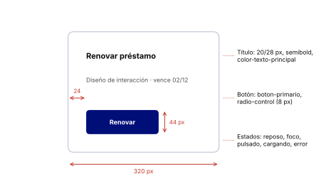

# Tema 11. Documentación, entrega y traspaso {#sec-tema11}

::: {.callout-note appearance="default"}
## Objetivos
- Anotar y especificar los diseños para el equipo de desarrollo.
- Organizar el control de versiones de los archivos de diseño.
- Presentar el diseño a los equipos de producto y desarrollo, y acompañar su construcción.
:::

::: {.callout-note appearance="simple" icon="false"}
## Glosario del tema
[Traspaso](92-glosario.qmd#gl-traspaso) · [Especificación](92-glosario.qmd#gl-especificacion) · [Anotación](92-glosario.qmd#gl-anotacion) · [Ruptura de diseño](92-glosario.qmd#gl-ruptura-diseno) · [Control de versiones](92-glosario.qmd#gl-versiones) · [Revisión de la implementación](92-glosario.qmd#gl-revision-implementacion)
:::

::: {.callout-tip appearance="simple" icon="false"}
## Descargas
[Plantilla de entrega del reto (.qmd)](plantillas/entrega_reto.qmd){.btn .btn-outline-primary .btn-sm download="entrega_reto.qmd"}
[Tema de estilo (.scss)](plantillas/informe.scss){.btn .btn-outline-primary .btn-sm download="informe.scss"}
:::

## Lectura obligatoria

::: {.lectura}
Maudet, N.; Leiva, G.; Beaudouin-Lafon, M.; Mackay, W. (2017). [Design breakdowns: Designer-developer gaps in representing and interpreting interactive systems](https://doi.org/10.1145/2998181.2998190). En *Proceedings of the 2017 ACM Conference on Computer Supported Cooperative Work and Social Computing (CSCW '17)* (pp. 630-641). ACM.
:::

### Lecturas complementarias {.unnumbered}

- Figma. [Dev Mode](https://help.figma.com/hc/en-us/articles/15023124644247-Guide-to-Dev-Mode). Inspección y especificaciones para desarrollo.
- Material Design 3 y otros sistemas: cómo documentan sus componentes para el desarrollo.

## 1. El traspaso no es un momento, es una relación

El **traspaso** (*handoff*) es el paso del diseño al equipo que lo construye. Maudet et al. (2017) estudiaron cómo colaboran diseñadores y desarrolladores y describieron las **rupturas de diseño** (*design breakdowns*): los puntos en los que lo que el diseño representa no basta para que el desarrollo lo interprete correctamente. Identificaron tres tipos recurrentes: **omitir detalles críticos** (cómo se comporta algo, qué pasa con los datos reales), **ignorar los casos límite** (textos larguísimos, listas vacías, errores) y **no tener en cuenta las limitaciones técnicas** (algo que no se puede construir como está dibujado).

También observaron que implicar pronto al equipo de desarrollo reducía esas rupturas, aunque surgían otras nuevas a medida que avanzaba el proyecto. La conclusión práctica es que el traspaso funciona mejor como una **colaboración continua** que como una entrega única al final.

## 2. Qué debe incluir la especificación

| Elemento | Qué documentar |
|---|---|
| **Flujos** | Pantallas, enlaces y recorridos principal, alternativos y de error |
| **Estilos y *tokens*** | Tipografía, color, espaciado, con los nombres del sistema de diseño (Tema 9) |
| **Componentes** | Qué componente del sistema es cada elemento, con su variante |
| **Estados** | Reposo, foco, desactivado, cargando, vacío, error, en cada pantalla |
| **Comportamiento adaptable** | Qué cambia en cada punto de ruptura (Tema 7) |
| **Interacciones** | Microinteracciones y animaciones, con su duración y la versión de movimiento reducido |
| **Contenido** | Textos definitivos, longitudes máximas, mensajes de error |
| **Accesibilidad** | Orden de foco, nombres accesibles, encabezados, textos alternativos |

Las herramientas de diseño permiten inspeccionar medidas y estilos, pero no explican el **porqué** ni los **casos límite**: eso va en las **anotaciones**.

## 3. Control de versiones

Los archivos de diseño cambian mientras se construye el producto. Para que todos trabajen sobre la versión correcta:

- **Una única fuente de verdad**: un archivo por producto, con páginas claras («En curso», «Listo para desarrollo», «Archivado»).
- **Versiones con nombre** en los hitos y un **registro de cambios** que diga qué ha cambiado y por qué.
- **Estado de cada pantalla** visible (en diseño, en revisión, lista, construida).
- **Ramas** para explorar cambios importantes sin alterar lo que ya está listo.

## 4. Presentar y acompañar

- Presentar el diseño al equipo **antes** de que empiece el desarrollo, recorriendo los flujos y los casos límite.
- Estar disponible durante la construcción para resolver dudas y negociar cambios.
- Hacer una **revisión de la implementación** (*design QA*): comparar lo construido con el diseño, incluida la accesibilidad, y priorizar las diferencias.
- Cerrar el ciclo: lo aprendido en la construcción alimenta el sistema de diseño.

## Práctica

Toma una pantalla de tu proyecto y pide a un compañero que la «construya» describiéndola solo con lo que ve en el archivo. Anota cada pregunta que te haga: cada una es una ruptura de diseño que la especificación debería haber resuelto.

{#fig-t11-especificacion fig-alt="Una tarjeta «Renovar préstamo» con un botón azul. Cotas en rojo indican un ancho de 320 píxeles, un margen de 24 y una altura de botón de 44 píxeles. Tres notas a la derecha: título 20/28 px semibold con color-texto-principal; botón con boton-primario y radio-control de 8 px; estados reposo, foco, pulsado, cargando y error."}

## Caso práctico resuelto

::: {.callout-note appearance="simple" icon="false"}
## Entrega a desarrollo sin ambigüedades
Paquete de entrega de la pantalla de reserva:

- **Especificaciones:** medidas, tokens usados, comportamiento en distintos tamaños.
- **Estados:** cargando, vacío, error, éxito y desactivado de cada componente.
- **Interacciones:** qué pasa al pulsar, duración de las animaciones, gestos.
- **Accesibilidad:** orden de foco, textos alternativos, etiquetas para lectores de pantalla, contraste comprobado.
- **Contenido:** textos finales, mensajes de error y su tono.
- **Casos límite:** nombres largos, sin conexión, sesión caducada.

Una reunión breve de traspaso y un canal para dudas evitan que desarrollo «rellene huecos» con decisiones propias.
:::

## Ejercicios graduados

**Básico.** Enumera cinco casos límite de la pantalla de reserva que deberían especificarse.

::: {.webex-solution boton="Ver solución"}
Sin conexión; sala ocupada mientras se confirma; nombre de sala muy largo; usuario sin permisos (por ejemplo, de otra universidad); reserva en la franja que ya ha empezado.
:::

**Avanzado.** Redacta la especificación completa de la barra de disponibilidad (aspecto, estados, interacción y accesibilidad).

::: {.webex-solution boton="Ver solución"}
Debe incluir tamaño y tokens, cómo se representan las horas libres y ocupadas (no solo con color), qué pasa al pulsar una franja, cómo se anuncia a un lector de pantalla («Libre de 16:00 a 18:00») y cómo se comporta en pantallas estrechas.
:::

## Actividades

::: {.clasificar #ia-t11a-espec titulo="¿Debe ir en la especificación?" categorias="Sí|No hace falta"}
- Los estados de cada componente (vacío, cargando, error) → Sí
- Los textos reales, incluidos los mensajes de error → Sí
- El comportamiento en móvil, tableta y escritorio → Sí
- Las notas de accesibilidad: orden del foco, textos alternativos, etiquetas → Sí
- La historia completa de todas las versiones descartadas → No hace falta // Basta con las decisiones y su porqué.
- Los tokens y componentes del sistema de diseño que se usan → Sí
:::

::: {.ordenar #ia-t11a-traspaso titulo="Ordena el traspaso al equipo de desarrollo"}
1. Revisar juntos el alcance y los criterios de aceptación
2. Recorrer los flujos y sus estados
3. Señalar los componentes del sistema y los nuevos
4. Resolver dudas técnicas y acordar cambios
5. Revisar la implementación frente al diseño
6. Registrar los cambios en el control de versiones
:::

::: {.clasificar #ia-t11a-versiones titulo="¿Buena práctica de control de versiones?" categorias="Buena práctica|Mala práctica"}
- Ficheros llamados «final_v3_ahora_si.fig» → Mala práctica
- Un registro de cambios que explica qué cambió y por qué → Buena práctica
- Ramas o páginas separadas para exploraciones y para lo aprobado → Buena práctica
- Cambiar el diseño aprobado sin avisar al equipo de desarrollo → Mala práctica
:::

::: {.callout-warning appearance="simple" icon="false"}
## Errores frecuentes
- **«Tirar el diseño por encima del muro»**: entregar y desaparecer.
- **Especificar solo el camino feliz**: faltan estados, errores y textos largos.
- **Medidas sueltas en lugar de tokens**: cada desarrollador interpreta un 15 o un 16 px a su manera.
- **No revisar la implementación**: el traspaso termina cuando el diseño funciona en producción.
:::

## Reto evaluable {#reto-t11}

::: {.callout-important appearance="simple" icon="false"}
## Reto del Tema 11 · Paquete de traspaso
Para el flujo principal de tu proyecto:

1. Prepara la **especificación** completa con la tabla del apartado 2, con anotaciones para los casos límite y la accesibilidad.
2. Organiza el archivo con una estructura de **versiones** y un registro de cambios.
3. Haz la prueba de la práctica con un compañero y documenta las **rupturas** detectadas y cómo las resuelves.
4. Prepara una **presentación** de diez minutos para un equipo de desarrollo.

**Entrega:** un informe hecho con la [plantilla de entrega](plantillas/entrega_reto.qmd) con el enlace al archivo. Se evalúa con la rúbrica que incluye la plantilla. Este reto **no tiene solución en el libro**: cada estudiante trabaja con un proyecto distinto y la corrección la hace el profesorado.
:::

## Autoevaluación

Responde a todas las preguntas y pulsa **Mostrar respuestas**: verás en verde las acertadas, en rojo las falladas y tu recuento. Puedes corregir y volver a comprobar. No cuenta para la nota.

::: {.webex-check .webex-box}
1. El traspaso funciona mejor como una entrega única al final del diseño. 
2. Según Maudet et al., los puntos en los que el diseño no basta para que el desarrollo lo interprete bien son 
3. Las herramientas de inspección de medidas explican por sí solas los casos límite y el porqué de las decisiones. 
4. ¿Qué debe incluir la especificación sobre accesibilidad? 
5. Comparar lo construido con el diseño para priorizar las diferencias es la 
6. ¿Para qué sirve tener una única fuente de verdad del diseño?


:::

::: {.webex-solution boton="Ver explicaciones"}
- Mejor como colaboración continua durante la construcción.
- *Design breakdowns*: detalles críticos omitidos, casos límite ignorados y limitaciones técnicas no consideradas.
- Por eso hacen falta las anotaciones.
- La accesibilidad se especifica desde el diseño.
- La revisión de la implementación (*design QA*) cierra el ciclo.
- Evita trabajar sobre versiones antiguas o duplicadas.
:::

## Recursos complementarios

| Recurso | Para qué sirve |
|---|---|
| [Figma – Guide to Dev Mode](https://help.figma.com/hc/en-us/articles/15023124644247-Guide-to-Dev-Mode) | Inspección para desarrollo |
| [Figma – Branching](https://help.figma.com/hc/en-us/articles/360063144053-Guide-to-branching) | Ramas en los archivos de diseño |
| [GOV.UK Design System](https://design-system.service.gov.uk/) | Ejemplo de documentación de componentes con código |
