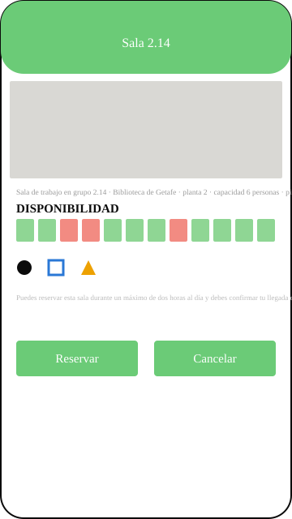
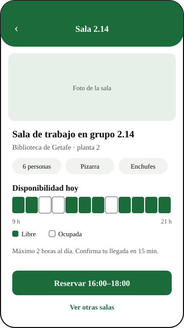

# Laboratorio de diseño visual {#sec-labvisual}

Este apéndice reúne herramientas interactivas para practicar las decisiones de alta fidelidad sobre el ejemplo de **ReservaSala**: comparar versiones, ajustar una escala tipográfica y una de espaciado, ver los estados reales de un componente y probar una microinteracción accesible. Todo funciona en tu navegador.

## Antes y después

::: {layout-ncol=2}
{#fig-m-antes fig-alt="Maqueta móvil de la sala 2.14 con cabecera verde claro y texto blanco, imagen gris, descripción en letra diminuta gris claro, disponibilidad en cuadros verdes y rojos, tres iconos de estilos distintos, normas en letra muy pequeña y dos botones verdes iguales Reservar y Cancelar."}

{#fig-m-despues fig-alt="Maqueta móvil rediseñada de la sala 2.14 con cabecera verde oscuro y botón atrás, foto, título grande, ubicación, etiquetas de capacidad, pizarra y enchufes, barra de disponibilidad en verde oscuro y huecos blancos con borde y leyenda Libre y Ocupada, norma en texto legible, botón principal Reservar 16:00–18:00 y enlace Ver otras salas."}
:::

::: {.zonas #ia-lab-antes titulo="¿Qué decisiones visuales fallan?" imagen="figuras/m_antes.svg" alt="Maqueta móvil con cabecera verde claro, imagen gris, texto diminuto, disponibilidad en verde y rojo, iconos mezclados, normas en letra muy pequeña y dos botones verdes iguales."}
La versión «antes» tiene **siete** problemas. Señálalos y comprueba.

- [0.3, 0.2, 99.4, 14] Cabecera verde claro con texto blanco | si | Contraste de unos 2:1, por debajo del 4,5:1 de WCAG AA.
- [3.3, 15.6, 93.3, 18.8] Imagen de la sala | no | La imagen ayuda a reconocer la sala.
- [5.5, 35.5, 92, 2.6] Descripción en letra diminuta y gris claro | si | Tamaño y contraste insuficientes para el texto que identifica la sala.
- [5.5, 41.5, 90, 5.5] Disponibilidad en verde y rojo | si | Depende solo del color: las personas con daltonismo no distinguen libre y ocupada.
- [4, 49.5, 30, 5] Tres iconos de estilos distintos | si | Mezcla de familias, sin etiquetas: no se sabe qué significan.
- [5.5, 56, 92, 3] Normas en letra muy pequeña | si | Información importante ilegible.
- [5.5, 65.6, 41.7, 6.9] Botón «Reservar» | si | Igual que «Cancelar»: no hay acción principal y su contraste es bajo.
- [52.8, 65.6, 41.7, 6.9] Botón «Cancelar» | si | Acción secundaria con el mismo peso que la principal.
:::

## Herramientas

::: {.panel-tabset}

### Escala tipográfica

```{ojs}
//| echo: false
rango = window.Lab.rango
seleccion = window.Lab.seleccion
casilla = window.Lab.casilla
viewof base = rango("Tamaño base (px)", [14, 20], {step: 1, value: 16})
viewof razon = seleccion("Razón de la escala", ["1,125 · segunda mayor", "1,2 · tercera menor", "1,25 · tercera mayor", "1,333 · cuarta justa", "1,5 · quinta justa"], {value: "1,25 · tercera mayor"})
```

```{ojs}
//| echo: false
{
  const k = parseFloat(razon.replace(",", "."));
  const niveles = [["Título de pantalla", 3, 600, "Sala 2.14"], ["Encabezado", 2, 600, "Disponibilidad hoy"], ["Subtítulo", 1, 600, "Biblioteca de Getafe"], ["Texto", 0, 400, "Máximo 2 horas al día. Confirma tu llegada en 15 minutos."], ["Pequeño", -1, 400, "Actualizado hace 2 minutos"]];
  const px = n => Math.round(base * Math.pow(k, n));
  const d = html`<div role="status"></div>`;
  d.innerHTML = `<div class="p-3 border rounded">${niveles.map(([n, e, w, s]) => `<div style="font-size:${px(e)}px;font-weight:${w};line-height:${e > 0 ? 1.25 : 1.5};margin:.25rem 0">${s}</div>`).join("")}</div>
   <table class="table table-sm mt-2"><thead><tr><th scope="col">Nivel</th><th scope="col">Tamaño</th><th scope="col">Token</th></tr></thead><tbody>${niveles.map(([n, e]) => `<tr><td>${n}</td><td>${px(e)} px</td><td><code>--fuente-${e >= 0 ? "n" + e : "menos1"}: ${px(e)}px;</code></td></tr>`).join("")}</tbody></table>
   <p class="small">${k >= 1.333 ? "Razón amplia: mucho contraste entre niveles; vigila que los títulos no ocupen demasiado en móvil." : k <= 1.125 ? "Razón estrecha: pocos contrastes; la jerarquía tendrá que apoyarse en el peso y el espacio." : "Razón equilibrada, habitual en interfaces."}</p>`;
  return d;
}
```

### Espaciado

```{ojs}
//| echo: false
viewof unidad = seleccion("Unidad base", ["4 px", "8 px"], {value: "8 px"})
viewof densidad = rango("Densidad (multiplicador)", [1, 3], {step: 1, value: 2})
```

```{ojs}
//| echo: false
{
  const u = parseInt(unidad), m = densidad;
  const esc = [1, 2, 3, 4, 6, 8].map(x => x * u);
  const d = html`<div role="status"></div>`;
  d.innerHTML = `<p>Escala: ${esc.map(x => `<code>${x}</code>`).join(" · ")} px</p>
   <div style="max-width:320px;border:1px solid var(--bs-border-color);border-radius:12px;padding:${u * m}px">
     <div style="font-weight:600;font-size:18px;margin-bottom:${u * m / 2}px">Sala 2.14</div>
     <div style="color:var(--bs-secondary-color);margin-bottom:${u * m}px">6 personas · planta 2</div>
     <button type="button" class="btn btn-primary w-100">Reservar</button>
   </div>
   <p class="small mt-2">Relleno de la tarjeta: ${u * m} px · separación título-detalle: ${u * m / 2} px. Los espacios pequeños unen lo relacionado; los grandes separan grupos.</p>`;
  return d;
}
```

### Estados de un botón

Pasa el ratón, pulsa y navega con el tabulador sobre estos botones reales: cada estado tiene su especificación.

```{=html}
<style>
.lv-btn{font:600 16px/1 inherit;padding:12px 20px;border-radius:10px;border:2px solid transparent;background:#1c6b3a;color:#fff;cursor:pointer;margin:6px 8px 6px 0;transition:background-color .15s ease, transform .1s ease}
.lv-btn:hover{background:#155a30}
.lv-btn:active{transform:translateY(1px);background:#0f4524}
.lv-btn:focus-visible{outline:3px solid #2a78d6;outline-offset:3px}
.lv-btn[disabled]{background:#d9d8d4;color:#52514e;cursor:not-allowed}
.lv-btn.secundario{background:transparent;color:#1c6b3a;border-color:#1c6b3a}
.quarto-dark .lv-btn.secundario{color:#8fd694;border-color:#8fd694}
.lv-btn.cargando::after{content:"";display:inline-block;width:12px;height:12px;margin-left:8px;border:2px solid #fff;border-right-color:transparent;border-radius:50%;animation:lv-giro .8s linear infinite;vertical-align:-1px}
@keyframes lv-giro{to{transform:rotate(360deg)}}
@media (prefers-reduced-motion: reduce){.lv-btn,.lv-btn.cargando::after{transition:none;animation:none}}
</style>
<div role="group" aria-label="Estados del botón">
<button class="lv-btn" type="button">Principal</button>
<button class="lv-btn secundario" type="button">Secundario</button>
<button class="lv-btn cargando" type="button" aria-busy="true">Reservando</button>
<button class="lv-btn" type="button" disabled>Desactivado</button>
</div>
```

| Estado | Especificación |
|---|---|
| Normal | Fondo `#1c6b3a`, texto blanco (contraste ≈ 6,9:1) |
| *Hover* | Fondo un 10 % más oscuro |
| Pulsado | Desplazamiento de 1 px y fondo más oscuro |
| Foco | Contorno azul de 3 px separado 3 px: visible con teclado |
| Cargando | Indicador giratorio y `aria-busy="true"`; sin animación si el usuario pide reducir el movimiento |
| Desactivado | Gris con texto oscuro; evita desactivar sin explicar por qué |

```{mermaid}
%%| fig-cap: "Estados del botón de reserva y transiciones entre ellos."
flowchart LR
  N[Normal] -->|puntero| H[Hover]
  H -->|sale| N
  N -->|tabulador| F[Foco]
  H -->|clic| P[Pulsado]
  F -->|Intro| P
  P -->|enviar| C[Cargando]
  C -->|200| E[Éxito]
  C -->|fallo| X[Error]
  X -->|reintentar| N
```

### Microinteracción

```{ojs}
//| echo: false
viewof reducir = casilla("Simular «reducir movimiento» del sistema", {value: false})
```

```{ojs}
//| echo: false
{
  const c = html`<div><button type="button" class="btn btn-primary">Reservar</button> <span class="ms-2" aria-live="polite"></span>
    <div style="height:10px;max-width:320px;background:var(--bs-secondary-bg);border-radius:5px;margin-top:12px;overflow:hidden"><div style="height:100%;width:0;background:#1c6b3a"></div></div></div>`;
  const [b, msg, barra] = [c.querySelector("button"), c.querySelector("span"), c.querySelector("div > div > div")];
  b.onclick = () => {
    msg.textContent = "Reservando…";
    barra.style.transition = reducir ? "none" : "width 1.2s ease-out";
    barra.style.width = "0"; void barra.offsetWidth; barra.style.width = "100%";
    setTimeout(() => { msg.textContent = "✓ Sala reservada"; }, reducir ? 50 : 1200);
  };
  return c;
}
```

La animación dura lo justo para dar retroalimentación (menos de 1,5 s), se acompaña de un mensaje que leen los lectores de pantalla (`aria-live`) y desaparece si el sistema pide **reducir el movimiento**.

:::

## Para tu proyecto

- Copia la tabla de **tokens** de la escala tipográfica a tu sistema de diseño.
- Especifica los **seis estados** de cada componente interactivo, como en la tabla del botón.
- Haz siempre una versión «antes y después» para justificar tus decisiones en la crítica.
